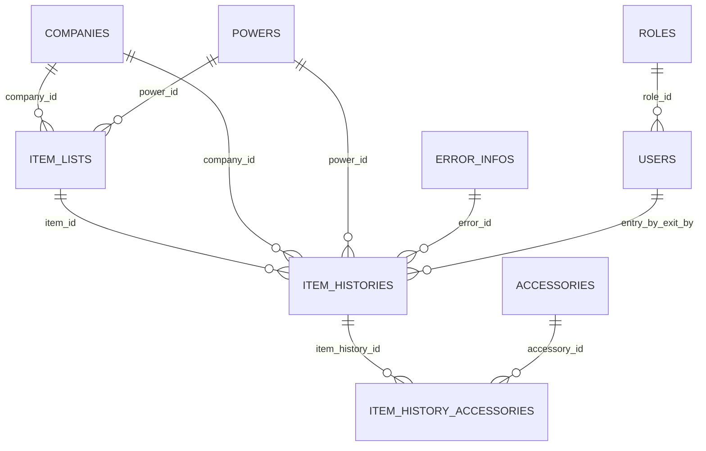
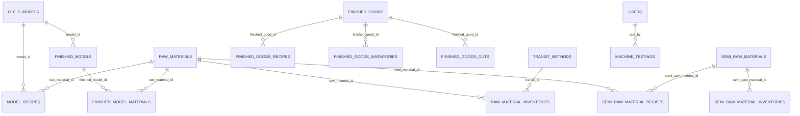
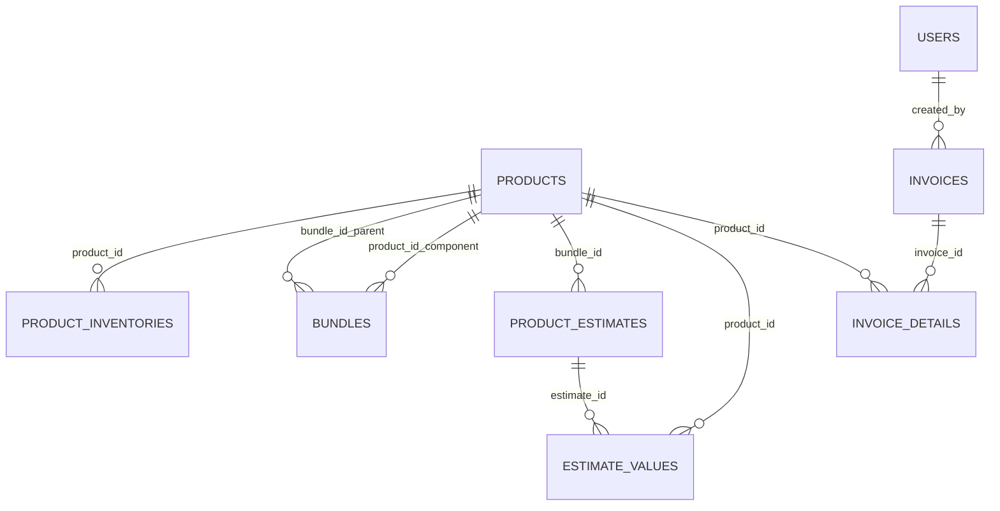

# Galaxy ERP — Database Relationships

> Audit date: **2026-11-05**, Asia/Karachi. This is a read-only application audit of the current working tree, including pre-existing uncommitted branding/table changes. Only these audit documents were created. No improvements described here are implemented or authorized by this report.

[Project Overview](PROJECT_OVERVIEW.md) | [Module Map](MODULE_MAP.md) | [Database Relationships](DATABASE_RELATIONSHIPS.md) | [Workflow Map](WORKFLOW_MAP.md) | [Ui Ux Audit](UI_UX_AUDIT.md) | [Security Audit](SECURITY_AUDIT.md) | [Performance Audit](PERFORMANCE_AUDIT.md) | [Improvement Roadmap](IMPROVEMENT_ROADMAP.md)

## Schema evidence and interpretation

All application migration files and all model declarations were inspected. Local metadata reports **47 tables, 63 index definitions, and zero foreign keys**. The diagrams below are **logical associations inferred from application fields/queries**, not enforced relational constraints. Framework/OAuth tables exist locally; package implementation/migration contents were excluded.

`finished_goods_recipes.material_id` points to RawMaterial or SemiRawMaterial depending on material_type; it is not a conventional single-target FK. `machine_testings.machine_barcode` and `serializations.serial_number` are logical serial strings, not linked manufactured-unit keys. `Unit` is a master list without quantity-bearing entity links.

Customers have no invoice/service FK. Product category, asset, income-account, and expense-account references are copied labels. InvoiceDetails does not store its component source bundle or price snapshots. Eloquent helpers sometimes express child-to-parent links as explicit-key hasOne; those currently resolve but should not be misreported as universally broken belongsTo replacements.

## Model relationship inventory

| Model file | Declared relationship methods | Important interpretation |
|---|---|---|
| [Accessories](../app/Models/Accessories.php) | None | No model casts beyond those explicitly declared; referential integrity is not enforced by these relations. |
| [Bundle](../app/Models/Bundle.php) | `productDetails()` → `hasOne(Products::class, 'id', 'product_id')` | No model casts beyond those explicitly declared; referential integrity is not enforced by these relations. |
| [Company](../app/Models/Company.php) | None | No model casts beyond those explicitly declared; referential integrity is not enforced by these relations. |
| [Customer](../app/Models/Customer.php) | None | Independent contact/account-information master, not a customer receivables ledger. |
| [ErrorInfo](../app/Models/ErrorInfo.php) | None | No model casts beyond those explicitly declared; referential integrity is not enforced by these relations. |
| [EstimateValue](../app/Models/EstimateValue.php) | `productDetails()` → `hasOne(Products::class, 'id', 'product_id')` | No model casts beyond those explicitly declared; referential integrity is not enforced by these relations. |
| [ExpenseAccount](../app/Models/ExpenseAccount.php) | None | No model casts beyond those explicitly declared; referential integrity is not enforced by these relations. |
| [FinishedGoods](../app/Models/FinishedGoods.php) | None | No model casts beyond those explicitly declared; referential integrity is not enforced by these relations. |
| [FinishedGoodsInventory](../app/Models/FinishedGoodsInventory.php) | `finishedGoods()` → `belongsTo(FinishedGoods::class, 'finished_good_id')` | No model casts beyond those explicitly declared; referential integrity is not enforced by these relations. |
| [FinishedGoodsOut](../app/Models/FinishedGoodsOut.php) | `finishedGoods()` → `belongsTo(FinishedGoods::class, 'finished_good_id')` `companyName()` → `belongsTo(Company::class, 'company_id')` `powerName()` → `belongsTo(Power::class, 'power_id')` | No model casts beyond those explicitly declared; referential integrity is not enforced by these relations. |
| [FinishedGoodsRecipe](../app/Models/FinishedGoodsRecipe.php) | `rawMaterial()` → `belongsTo(RawMaterial::class, 'material_id')` `semiRawMaterial()` → `belongsTo(SemiRawMaterial::class, 'material_id')` | Both target types share material_id; choose by material_type. |
| [FinishedModelMaterial](../app/Models/FinishedModelMaterial.php) | `rawMaterial()` → `belongsTo(RawMaterial::class, 'raw_material_id')` | No model casts beyond those explicitly declared; referential integrity is not enforced by these relations. |
| [FinishedModels](../app/Models/FinishedModels.php) | `modelDetail()` → `belongsTo(UPSModel::class, 'model_id')` `user()` → `belongsTo(User::class, 'created_by')` `modelMaterial()` → `hasMany(FinishedModelMaterial::class, 'finished_model_id', 'id')` | No model casts beyond those explicitly declared; referential integrity is not enforced by these relations. |
| [IncomeAccount](../app/Models/IncomeAccount.php) | None | No model casts beyond those explicitly declared; referential integrity is not enforced by these relations. |
| [Invoice](../app/Models/Invoice.php) | `createdBy()` → `belongsTo(User::class, 'created_by', 'id')` `invoiceDetails()` → `hasMany(InvoiceDetails::class, 'invoice_id')` | No model casts beyond those explicitly declared; referential integrity is not enforced by these relations. |
| [InvoiceDetails](../app/Models/InvoiceDetails.php) | `productDetails()` → `belongsTo(Products::class, 'product_id', 'id')` | No model casts beyond those explicitly declared; referential integrity is not enforced by these relations. |
| [ItemHistory](../app/Models/ItemHistory.php) | `Item()` → `hasOne(ItemList::class,'id','item_id')` `Power()` → `hasOne(Power::class,'id','power_id')` `Company()` → `hasOne(Company::class,'id','company_id')` `Error()` → `hasOne(ErrorInfo::class,'id','error_id')` `ExitBy()` → `hasOne(User::class,'id','exit_by')` `EntryBy()` → `hasOne(User::class,'id','entry_by')` `machineAccessories()` → `hasMany(ItemHistoryAccessory::class, 'item_history_id')` `exitMachineAccessories()` → `hasMany(ItemHistoryAccessory::class, 'item_history_id')->where('status',1)` `exitMachineAccessoriesLeft()` → `hasMany(ItemHistoryAccessory::class, 'item_history_id')->where('status',0)` | No model casts beyond those explicitly declared; referential integrity is not enforced by these relations. |
| [ItemHistoryAccessory](../app/Models/ItemHistoryAccessory.php) | `Accessory()` → `hasOne(Accessories::class,'id','accessory_id')` | No model casts beyond those explicitly declared; referential integrity is not enforced by these relations. |
| [ItemList](../app/Models/ItemList.php) | `Company()` → `hasOne(Company::class,'id','company_id')` `Power()` → `hasOne(Power::class,'id','power_id')` `machineHistory()` → `hasMany(ItemHistory::class, 'item_id')->where('status',1)` | machineHistory() filters status=1: it excludes open service history. |
| [MachineTesting](../app/Models/MachineTesting.php) | `user()` → `belongsTo(User::class, 'test_by')` | No model casts beyond those explicitly declared; referential integrity is not enforced by these relations. |
| [ModelRecipe](../app/Models/ModelRecipe.php) | `rawMaterial()` → `belongsTo(RawMaterial::class, 'raw_material_id')` | No model casts beyond those explicitly declared; referential integrity is not enforced by these relations. |
| [Power](../app/Models/Power.php) | None | No model casts beyond those explicitly declared; referential integrity is not enforced by these relations. |
| [ProductAsset](../app/Models/ProductAsset.php) | None | No model casts beyond those explicitly declared; referential integrity is not enforced by these relations. |
| [ProductCategory](../app/Models/ProductCategory.php) | None | No model casts beyond those explicitly declared; referential integrity is not enforced by these relations. |
| [ProductEstimate](../app/Models/ProductEstimate.php) | `bundleDetails()` → `hasOne(Products::class, 'id', 'bundle_id')` `estimateDetails()` → `hasMany(EstimateValue::class, 'estimate_id')` | No model casts beyond those explicitly declared; referential integrity is not enforced by these relations. |
| [ProductInventory](../app/Models/ProductInventory.php) | `productDetails()` → `hasOne(Products::class, 'id', 'product_id')` `entryBy()` → `hasOne(User::class, 'id', 'entry_by')` `receivedBy()` → `hasOne(User::class, 'id', 'received_by')` | No model casts beyond those explicitly declared; referential integrity is not enforced by these relations. |
| [Products](../app/Models/Products.php) | `bundleDetails()` → `hasMany(Bundle::class, 'bundle_id')` `estimateValues()` → `hasMany(EstimateValue::class, 'product_id')` `productInventory()` → `hasMany(ProductInventory::class, 'product_id')->where('status', 1)` | productInventory() filters status=1: pending receipts are excluded. |
| [RawMaterial](../app/Models/RawMaterial.php) | None | No model casts beyond those explicitly declared; referential integrity is not enforced by these relations. |
| [RawMaterialInventory](../app/Models/RawMaterialInventory.php) | `rawMaterial()` → `hasOne(RawMaterial::class,'id','raw_material_id')` `transitMethod()` → `hasOne(TransitMethod::class,'id','transit_id')` `entryBy()` → `hasOne(User::class,'id','entry_by')` `receivedBy()` → `hasOne(User::class,'id','received_by')` | No model casts beyond those explicitly declared; referential integrity is not enforced by these relations. |
| [SemiRawMaterial](../app/Models/SemiRawMaterial.php) | None | No model casts beyond those explicitly declared; referential integrity is not enforced by these relations. |
| [SemiRawMaterialInventory](../app/Models/SemiRawMaterialInventory.php) | `rawMaterial()` → `belongsTo(SemiRawMaterial::class, 'semi_raw_material_id')` | No model casts beyond those explicitly declared; referential integrity is not enforced by these relations. |
| [SemiRawMaterialRecipe](../app/Models/SemiRawMaterialRecipe.php) | `rawMaterial()` → `belongsTo(RawMaterial::class, 'raw_material_id')` | No model casts beyond those explicitly declared; referential integrity is not enforced by these relations. |
| [Serialization](../app/Models/Serialization.php) | None | Model is a string; there is no declared relationship. |
| [TransitMethod](../app/Models/TransitMethod.php) | None | No model casts beyond those explicitly declared; referential integrity is not enforced by these relations. |
| [UPSModel](../app/Models/UPSModel.php) | None | Default table name is u_p_s_models. |
| [Unit](../app/Models/Unit.php) | None | No model casts beyond those explicitly declared; referential integrity is not enforced by these relations. |
| [User](../app/Models/User.php) | `Role()` → `hasOne(roles::class,'id','role_id')` | Password and remember_token are hidden; only email_verified_at has a cast. |
| [roles](../app/Models/roles.php) | `User()` → `belongsTo(User::class)` | User() inverse is incorrect; see DB-04. |

## Local schema dictionary

Column types and nullable/key flags are structural metadata only. No connection values, row contents, personal details, or business balances are included. `PRI` is a primary-key flag; other non-primary indexes are listed separately.

### `accessories`

`created_at` timestamp nullable, `id` bigint PRI, `name` varchar nullable, `status` tinyint, `updated_at` timestamp nullable.

Indexes: unique `PRIMARY` (id).

### `bundles`

`bundle_id` int nullable, `created_at` timestamp nullable, `id` bigint PRI, `product_id` int nullable, `quantity` int nullable, `status` int nullable, `updated_at` timestamp nullable.

Indexes: unique `PRIMARY` (id).

### `companies`

`created_at` timestamp nullable, `id` bigint PRI, `name` varchar nullable, `status` tinyint, `updated_at` timestamp nullable.

Indexes: unique `PRIMARY` (id).

### `customers`

`attachment` varchar nullable, `city` varchar nullable, `company_name` varchar nullable, `country` varchar nullable, `created_at` timestamp nullable, `date` date nullable, `delivery_option` varchar nullable, `display_name` varchar nullable, `email` varchar nullable, `fax` varchar nullable, `first_name` varchar nullable, `id` bigint PRI, `language` varchar nullable, `last_name` varchar nullable, `middle_name` varchar nullable, `mobile` varchar nullable, `notes` varchar nullable, `opening_balance` varchar nullable, `other` varchar nullable, `payment_method` varchar nullable, `phone` varchar nullable, `postal_code` varchar nullable, `province` varchar nullable, `street_address_one` varchar nullable, `street_address_two` varchar nullable, `suffix` varchar nullable, `taxes` varchar nullable, `terms` varchar nullable, `title` varchar nullable, `updated_at` timestamp nullable, `website` varchar nullable.

Indexes: unique `PRIMARY` (id).

### `error_infos`

`created_at` timestamp nullable, `description` varchar nullable, `id` bigint PRI, `name` varchar nullable, `status` tinyint, `updated_at` timestamp nullable.

Indexes: unique `PRIMARY` (id).

### `estimate_values`

`bundle_id` int nullable, `created_at` timestamp nullable, `estimate_id` int nullable, `id` bigint PRI, `product_id` int nullable, `quantity_in_stock` int nullable, `quantity_needed` int nullable, `updated_at` timestamp nullable.

Indexes: unique `PRIMARY` (id).

### `expense_accounts`

`created_at` timestamp nullable, `id` bigint PRI, `name` varchar nullable, `updated_at` timestamp nullable.

Indexes: unique `PRIMARY` (id).

### `failed_jobs`

`connection` text, `exception` longtext, `failed_at` timestamp, `id` bigint PRI, `payload` longtext, `queue` text, `uuid` varchar UNI.

Indexes: unique `failed_jobs_uuid_unique` (uuid); unique `PRIMARY` (id).

### `finished_goods`

`created_at` timestamp nullable, `current_stock` double nullable, `id` bigint PRI, `name` varchar nullable, `status` tinyint, `temp_stock` double nullable, `updated_at` timestamp nullable.

Indexes: unique `PRIMARY` (id).

### `finished_goods_inventories`

`created_at` timestamp nullable, `finished_good_id` int nullable, `id` bigint PRI, `remarks` varchar nullable, `status` tinyint, `stock_in` double nullable, `transit_id` int nullable, `updated_at` timestamp nullable.

Indexes: unique `PRIMARY` (id).

### `finished_goods_outs`

`company_id` int nullable, `created_at` timestamp nullable, `customer_name` varchar nullable, `finished_good_id` int nullable, `id` bigint PRI, `model` varchar nullable, `power_id` int nullable, `sale_date` date nullable, `sale_quantity` double nullable, `updated_at` timestamp nullable.

Indexes: unique `PRIMARY` (id).

### `finished_goods_recipes`

`created_at` timestamp nullable, `finished_good_id` int nullable, `id` bigint PRI, `material_id` int nullable, `material_type` varchar nullable, `qty` double nullable, `status` tinyint, `updated_at` timestamp nullable.

Indexes: unique `PRIMARY` (id).

### `finished_model_materials`

`created_at` timestamp nullable, `finished_model_id` int nullable, `id` bigint PRI, `qty` double nullable, `raw_material_id` int nullable, `remain_qty` double nullable, `status` tinyint nullable, `updated_at` timestamp nullable.

Indexes: unique `PRIMARY` (id).

### `finished_models`

`created_at` timestamp nullable, `created_by` int nullable, `id` bigint PRI, `is_complete` int, `model_id` int nullable, `serial_number` varchar nullable, `status` int nullable, `updated_at` timestamp nullable.

Indexes: unique `PRIMARY` (id).

### `income_accounts`

`created_at` timestamp nullable, `id` bigint PRI, `name` varchar nullable, `updated_at` timestamp nullable.

Indexes: unique `PRIMARY` (id).

### `invoice_details`

`created_at` timestamp nullable, `id` bigint PRI, `invoice_id` int nullable, `product_id` int nullable, `product_qty` int nullable, `updated_at` timestamp nullable.

Indexes: unique `PRIMARY` (id).

### `invoices`

`created_at` timestamp nullable, `created_by` int nullable, `id` bigint PRI, `invoice_name` varchar nullable, `invoice_number` varchar nullable, `total_count` int nullable, `updated_at` timestamp nullable.

Indexes: unique `PRIMARY` (id).

### `item_histories`

`company_id` int nullable MUL, `cost` double, `created_at` timestamp nullable MUL, `created_by` int nullable, `entry_by` int nullable, `entry_date` date nullable MUL, `error_description` varchar nullable, `error_id` int nullable MUL, `exit_by` int nullable, `exit_date` date nullable MUL, `id` bigint PRI, `item_id` int nullable, `maker_name` varchar nullable, `model` varchar nullable, `name` varchar nullable, `packing_status` tinyint, `phone` varchar nullable, `power_id` int nullable MUL, `receiver_name` varchar nullable, `resolution` varchar nullable, `status` int MUL, `updated_at` timestamp nullable, `warranty_status` varchar nullable.

Indexes: `item_histories_company_id_index` (company_id); `item_histories_created_at_index` (created_at); `item_histories_entry_date_index` (entry_date); `item_histories_error_id_index` (error_id); `item_histories_exit_date_index` (exit_date); `item_histories_power_id_index` (power_id); `item_histories_status_index` (status); unique `PRIMARY` (id).

### `item_history_accessories`

`accessory_id` int nullable MUL, `created_at` timestamp nullable, `id` bigint PRI, `item_history_id` int nullable, `status` int, `updated_at` timestamp nullable.

Indexes: `item_history_accessories_accessory_id_index` (accessory_id); unique `PRIMARY` (id).

### `item_lists`

`company_id` int nullable, `created_at` timestamp nullable, `id` bigint PRI, `maker_name` varchar nullable, `model` varchar nullable, `power_id` int nullable, `production_date` date nullable, `serial_number` varchar nullable, `updated_at` timestamp nullable, `warranty_years` int nullable.

Indexes: unique `PRIMARY` (id).

### `machine_testings`

`agm_chg_amp` varchar nullable, `barcode` varchar nullable, `button_test` varchar nullable, `check_on_grid` varchar nullable, `ck_amp_d` varchar nullable, `created_at` timestamp nullable, `direct_pv_run` varchar nullable, `dual_out_test` varchar nullable, `fld_chg_amp` varchar nullable, `id` bigint PRI, `inductive_load_test` varchar nullable, `inp_series` varchar nullable, `ld_inp_series` varchar nullable, `machine_barcode` varchar nullable, `no_ld_sharing` varchar nullable, `no_load_voltage` varchar nullable, `off_grid` varchar nullable, `ovl_test_bat` varchar nullable, `ovl_test_power` varchar nullable, `pv_series` varchar nullable, `short_circuit` varchar nullable, `supply_amp` varchar nullable, `test_by` varchar nullable, `total_time` varchar nullable, `updated_at` timestamp nullable, `wapda_check` varchar nullable, `wifi_light` varchar nullable.

Indexes: unique `PRIMARY` (id).

### `migrations`

`batch` int, `id` int PRI, `migration` varchar.

Indexes: unique `PRIMARY` (id).

### `model_recipes`

`created_at` timestamp nullable, `id` bigint PRI, `model_id` int nullable, `qty` double nullable, `raw_material_id` int nullable, `status` tinyint, `updated_at` timestamp nullable.

Indexes: unique `PRIMARY` (id).

### `oauth_access_tokens`

`client_id` bigint, `created_at` timestamp nullable, `expires_at` datetime nullable, `id` varchar PRI, `name` varchar nullable, `revoked` tinyint, `scopes` text nullable, `updated_at` timestamp nullable, `user_id` bigint nullable MUL.

Indexes: `oauth_access_tokens_user_id_index` (user_id); unique `PRIMARY` (id).

### `oauth_auth_codes`

`client_id` bigint, `expires_at` datetime nullable, `id` varchar PRI, `revoked` tinyint, `scopes` text nullable, `user_id` bigint MUL.

Indexes: `oauth_auth_codes_user_id_index` (user_id); unique `PRIMARY` (id).

### `oauth_clients`

`created_at` timestamp nullable, `id` bigint PRI, `name` varchar, `password_client` tinyint, `personal_access_client` tinyint, `provider` varchar nullable, `redirect` text, `revoked` tinyint, `secret` varchar nullable, `updated_at` timestamp nullable, `user_id` bigint nullable MUL.

Indexes: `oauth_clients_user_id_index` (user_id); unique `PRIMARY` (id).

### `oauth_personal_access_clients`

`client_id` bigint, `created_at` timestamp nullable, `id` bigint PRI, `updated_at` timestamp nullable.

Indexes: unique `PRIMARY` (id).

### `oauth_refresh_tokens`

`access_token_id` varchar MUL, `expires_at` datetime nullable, `id` varchar PRI, `revoked` tinyint.

Indexes: `oauth_refresh_tokens_access_token_id_index` (access_token_id); unique `PRIMARY` (id).

### `password_resets`

`created_at` timestamp nullable, `email` varchar MUL, `token` varchar.

Indexes: `password_resets_email_index` (email).

### `personal_access_tokens`

`abilities` text nullable, `created_at` timestamp nullable, `id` bigint PRI, `last_used_at` timestamp nullable, `name` varchar, `token` varchar UNI, `tokenable_id` bigint, `tokenable_type` varchar MUL, `updated_at` timestamp nullable.

Indexes: unique `personal_access_tokens_token_unique` (token); `personal_access_tokens_tokenable_type_tokenable_id_index` (tokenable_type,tokenable_id); unique `PRIMARY` (id).

### `powers`

`created_at` timestamp nullable, `id` bigint PRI, `name` varchar nullable, `updated_at` timestamp nullable.

Indexes: unique `PRIMARY` (id).

### `product_assets`

`created_at` timestamp nullable, `id` bigint PRI, `name` varchar nullable, `updated_at` timestamp nullable.

Indexes: unique `PRIMARY` (id).

### `product_categories`

`created_at` timestamp nullable, `id` bigint PRI, `name` varchar nullable, `status` tinyint, `updated_at` timestamp nullable.

Indexes: unique `PRIMARY` (id).

### `product_estimates`

`bundle_id` int nullable, `created_at` timestamp nullable, `id` bigint PRI, `number` varchar nullable, `quantity` int nullable, `status` int, `title` varchar nullable, `updated_at` timestamp nullable.

Indexes: unique `PRIMARY` (id).

### `product_inventories`

`created_at` timestamp nullable, `description` varchar nullable, `entry_by` int nullable, `expected_date` date nullable, `id` bigint PRI, `product_id` int nullable, `production_date` date nullable, `received_by` int nullable, `received_stock` int, `remaining_stock` int, `status` int nullable, `stock_in` varchar nullable, `transit_id` int nullable, `updated_at` timestamp nullable.

Indexes: unique `PRIMARY` (id).

### `products`

`air_transit` varchar nullable, `category` varchar nullable, `cost` varchar nullable, `created_at` timestamp nullable, `date` varchar nullable, `description` varchar nullable, `expense_account` varchar nullable, `id` bigint PRI, `image` varchar nullable, `income_account` varchar nullable, `initial_qty` varchar nullable, `inventory_asset` varchar nullable, `name` varchar nullable, `purchase_info` varchar nullable, `re_order` varchar nullable, `sale_price` varchar nullable, `sea_transit` varchar nullable, `sku` varchar nullable, `status` int, `temp_qty` varchar nullable, `total_qty` varchar nullable, `type` varchar nullable, `updated_at` timestamp nullable.

Indexes: unique `PRIMARY` (id).

### `raw_material_inventories`

`created_at` timestamp nullable, `entry_by` int nullable, `id` bigint PRI, `raw_material_id` int nullable, `received_by` int nullable, `remarks` varchar nullable, `status` tinyint, `stock_in` double nullable, `transit_id` int nullable, `updated_at` timestamp nullable.

Indexes: unique `PRIMARY` (id).

### `raw_materials`

`created_at` timestamp nullable, `current_stock` double nullable, `id` bigint PRI, `name` varchar nullable, `status` tinyint, `temp_stock` double nullable, `transit_stock` double, `updated_at` timestamp nullable.

Indexes: unique `PRIMARY` (id).

### `roles`

`created_at` timestamp nullable, `id` bigint PRI, `role` varchar, `updated_at` timestamp nullable.

Indexes: unique `PRIMARY` (id).

### `semi_raw_material_inventories`

`created_at` timestamp nullable, `id` bigint PRI, `remarks` varchar nullable, `semi_raw_material_id` int nullable, `status` tinyint, `stock_in` double nullable, `transit_id` int nullable, `updated_at` timestamp nullable.

Indexes: unique `PRIMARY` (id).

### `semi_raw_material_recipes`

`created_at` timestamp nullable, `id` bigint PRI, `qty` int nullable, `raw_material_id` int nullable, `semi_raw_material_id` int nullable, `updated_at` timestamp nullable.

Indexes: unique `PRIMARY` (id).

### `semi_raw_materials`

`created_at` timestamp nullable, `current_stock` double nullable, `id` bigint PRI, `name` varchar nullable, `status` tinyint, `temp_stock` double nullable, `updated_at` timestamp nullable.

Indexes: unique `PRIMARY` (id).

### `serializations`

`created_at` timestamp nullable, `created_by` int nullable, `customer_city` varchar nullable, `customer_name` varchar nullable, `date` date nullable, `dealer_city` varchar nullable, `dealer_name` varchar nullable, `delivery_boy` varchar nullable, `id` bigint PRI, `model` varchar nullable, `serial_number` varchar nullable, `updated_at` timestamp nullable.

Indexes: unique `PRIMARY` (id).

### `transit_methods`

`created_at` timestamp nullable, `id` bigint PRI, `name` varchar nullable, `status` tinyint, `updated_at` timestamp nullable.

Indexes: unique `PRIMARY` (id).

### `u_p_s_models`

`created_at` timestamp nullable, `id` bigint PRI, `name` varchar nullable, `qty` double nullable, `semi_qty` double nullable, `semi_temp_qty` double nullable, `status` tinyint, `temp_qty` double nullable, `updated_at` timestamp nullable.

Indexes: unique `PRIMARY` (id).

### `units`

`created_at` timestamp nullable, `created_by` int nullable, `id` bigint PRI, `name` varchar nullable, `status` tinyint, `unit` varchar nullable, `updated_at` timestamp nullable, `updated_by` int nullable.

Indexes: unique `PRIMARY` (id).

### `users`

`created_at` timestamp nullable, `email` varchar UNI, `email_verified_at` timestamp nullable, `id` bigint PRI, `name` varchar, `password` varchar, `remember_token` varchar nullable, `role_id` int nullable, `status` tinyint, `updated_at` timestamp nullable.

Indexes: unique `PRIMARY` (id); unique `users_email_unique` (email).

## Migration inventory and recovery cautions

The current repository contains the application migrations below. Package-provided OAuth schema is visible in local metadata but its excluded dependency source was not inspected. No migration history was changed and no fresh/migrate/rollback command was executed.

| Migration file | Forward schema operations | Rollback shape |
|---|---|---|
| [2014_10_12_000000_create_users_table.php](../database/migrations/2014_10_12_000000_create_users_table.php) | create users | drops table |
| [2014_10_12_100000_create_password_resets_table.php](../database/migrations/2014_10_12_100000_create_password_resets_table.php) | create password_resets | drops table |
| [2019_08_19_000000_create_failed_jobs_table.php](../database/migrations/2019_08_19_000000_create_failed_jobs_table.php) | create failed_jobs | drops table |
| [2019_12_14_000001_create_personal_access_tokens_table.php](../database/migrations/2019_12_14_000001_create_personal_access_tokens_table.php) | create personal_access_tokens | drops table |
| [2022_10_14_101332_create_roles_table.php](../database/migrations/2022_10_14_101332_create_roles_table.php) | create roles | drops table |
| [2023_02_15_161646_update_user_table.php](../database/migrations/2023_02_15_161646_update_user_table.php) | table users | empty/non-reversing table callback |
| [2023_02_15_161901_create_companies_table.php](../database/migrations/2023_02_15_161901_create_companies_table.php) | create companies | drops table |
| [2023_02_15_161913_create_error_infos_table.php](../database/migrations/2023_02_15_161913_create_error_infos_table.php) | create error_infos | drops table |
| [2023_02_15_161922_create_powers_table.php](../database/migrations/2023_02_15_161922_create_powers_table.php) | create powers | drops table |
| [2023_02_15_161931_create_accessories_table.php](../database/migrations/2023_02_15_161931_create_accessories_table.php) | create accessories | drops table |
| [2023_02_17_174225_create_item_lists_table.php](../database/migrations/2023_02_17_174225_create_item_lists_table.php) | create item_lists | drops table |
| [2023_02_17_174239_create_item_histories_table.php](../database/migrations/2023_02_17_174239_create_item_histories_table.php) | create item_histories | drops table |
| [2023_02_17_174251_create_item_history_accessories_table.php](../database/migrations/2023_02_17_174251_create_item_history_accessories_table.php) | create item_history_accessories | drops table |
| [2023_02_24_104105_update_item_list.php](../database/migrations/2023_02_24_104105_update_item_list.php) | table item_lists | empty/non-reversing table callback |
| [2023_02_27_141416_update_item_list_table.php](../database/migrations/2023_02_27_141416_update_item_list_table.php) | table item_lists | empty/non-reversing table callback |
| [2023_03_03_153320_update_item_histories_table_one.php](../database/migrations/2023_03_03_153320_update_item_histories_table_one.php) | table item_histories | empty/non-reversing table callback |
| [2023_03_03_165203_update_item_list_table_two.php](../database/migrations/2023_03_03_165203_update_item_list_table_two.php) | table item_lists | empty/non-reversing table callback |
| [2023_04_24_172113_create_units_table.php](../database/migrations/2023_04_24_172113_create_units_table.php) | create units | drops table |
| [2023_04_24_172124_create_raw_materials_table.php](../database/migrations/2023_04_24_172124_create_raw_materials_table.php) | create raw_materials | drops table |
| [2023_04_24_172145_create_semi_raw_materials_table.php](../database/migrations/2023_04_24_172145_create_semi_raw_materials_table.php) | create semi_raw_materials | drops table |
| [2023_04_24_172157_create_finished_goods_table.php](../database/migrations/2023_04_24_172157_create_finished_goods_table.php) | create finished_goods | drops table |
| [2023_04_24_172211_create_transit_methods_table.php](../database/migrations/2023_04_24_172211_create_transit_methods_table.php) | create transit_methods | drops table |
| [2023_04_24_172223_create_raw_material_inventories_table.php](../database/migrations/2023_04_24_172223_create_raw_material_inventories_table.php) | create raw_material_inventories | drops table |
| [2023_04_24_172231_create_semi_raw_material_inventories_table.php](../database/migrations/2023_04_24_172231_create_semi_raw_material_inventories_table.php) | create semi_raw_material_inventories | drops table |
| [2023_04_24_172249_create_finished_goods_inventories_table.php](../database/migrations/2023_04_24_172249_create_finished_goods_inventories_table.php) | create finished_goods_inventories | drops table |
| [2023_04_24_172322_create_semi_finished_goods_recipes_table.php](../database/migrations/2023_04_24_172322_create_semi_finished_goods_recipes_table.php) | create semi_finished_goods_recipes | drops table |
| [2023_04_24_172328_create_finished_goods_recipes_table.php](../database/migrations/2023_04_24_172328_create_finished_goods_recipes_table.php) | create finished_goods_recipes | drops table |
| [2023_05_06_230316_create_semi_raw_material_recipes_table.php](../database/migrations/2023_05_06_230316_create_semi_raw_material_recipes_table.php) | create semi_raw_material_recipes | drops table |
| [2023_05_06_232327_drop_semi_finished_goods_recipes_table.php](../database/migrations/2023_05_06_232327_drop_semi_finished_goods_recipes_table.php) | dropIfExists semi_finished_goods_recipes | empty/non-reversing table callback |
| [2023_05_06_232722_update_finished_goods_recipe.php](../database/migrations/2023_05_06_232722_update_finished_goods_recipe.php) | table finished_goods_recipes | empty/non-reversing table callback |
| [2023_05_11_162800_create_finished_goods_outs_table.php](../database/migrations/2023_05_11_162800_create_finished_goods_outs_table.php) | create finished_goods_outs | drops table |
| [2023_05_11_163937_update_finished_goods_out.php](../database/migrations/2023_05_11_163937_update_finished_goods_out.php) | table finished_goods_outs | empty/non-reversing table callback |
| [2023_06_02_171457_update_raw_material_inventories_table.php](../database/migrations/2023_06_02_171457_update_raw_material_inventories_table.php) | table raw_material_inventories | empty/non-reversing table callback |
| [2023_06_09_154202_add_transit_stock_to_raw_materials_table.php](../database/migrations/2023_06_09_154202_add_transit_stock_to_raw_materials_table.php) | table raw_materials | empty/non-reversing table callback |
| [2023_09_14_131139_update_item_histories_one.php](../database/migrations/2023_09_14_131139_update_item_histories_one.php) | table item_histories | empty |
| [2023_12_21_142848_create_serializations_table.php](../database/migrations/2023_12_21_142848_create_serializations_table.php) | create serializations | drops table |
| [2024_01_04_130627_create_u_p_s_models_table.php](../database/migrations/2024_01_04_130627_create_u_p_s_models_table.php) | create u_p_s_models | drops table |
| [2024_01_04_130643_create_model_recipes_table.php](../database/migrations/2024_01_04_130643_create_model_recipes_table.php) | create model_recipes | drops table |
| [2024_01_05_123229_update_ups_model.php](../database/migrations/2024_01_05_123229_update_ups_model.php) | table u_p_s_models | empty/non-reversing table callback |
| [2024_01_05_151459_create_finished_models_table.php](../database/migrations/2024_01_05_151459_create_finished_models_table.php) | create finished_models | drops table |
| [2024_01_07_194452_update_finished_models.php](../database/migrations/2024_01_07_194452_update_finished_models.php) | table finished_models | empty/non-reversing table callback |
| [2024_01_07_210152_create_finished_model_materials_table.php](../database/migrations/2024_01_07_210152_create_finished_model_materials_table.php) | create finished_model_materials | drops table |
| [2024_01_08_151219_update_finished_models_material.php](../database/migrations/2024_01_08_151219_update_finished_models_material.php) | table finished_model_materials | empty/non-reversing table callback |
| [2024_04_26_164526_create_machine_testings_table.php](../database/migrations/2024_04_26_164526_create_machine_testings_table.php) | create machine_testings | drops table |
| [2024_12_22_200950_create_products_table.php](../database/migrations/2024_12_22_200950_create_products_table.php) | create products | drops table |
| [2024_12_24_151026_create_product_inventories_table.php](../database/migrations/2024_12_24_151026_create_product_inventories_table.php) | create product_inventories | drops table |
| [2024_12_24_165923_create_product_categories_table.php](../database/migrations/2024_12_24_165923_create_product_categories_table.php) | create product_categories | drops table |
| [2024_12_24_172331_create_product_assets_table.php](../database/migrations/2024_12_24_172331_create_product_assets_table.php) | create product_assets | drops table |
| [2024_12_25_195056_create_income_accounts_table.php](../database/migrations/2024_12_25_195056_create_income_accounts_table.php) | create income_accounts | drops table |
| [2024_12_25_195114_create_expense_accounts_table.php](../database/migrations/2024_12_25_195114_create_expense_accounts_table.php) | create expense_accounts | drops table |
| [2024_12_26_155123_create_bundles_table.php](../database/migrations/2024_12_26_155123_create_bundles_table.php) | create bundles | drops table |
| [2024_12_30_125913_create_customers_table.php](../database/migrations/2024_12_30_125913_create_customers_table.php) | create customers | drops table |
| [2025_01_02_152628_create_product_estimates_table.php](../database/migrations/2025_01_02_152628_create_product_estimates_table.php) | create product_estimates | drops table |
| [2025_01_02_152639_create_estimate_values_table.php](../database/migrations/2025_01_02_152639_create_estimate_values_table.php) | create estimate_values | drops table |
| [2025_01_07_145345_update_products_table.php](../database/migrations/2025_01_07_145345_update_products_table.php) | table products, table product_inventories | empty/non-reversing table callback |
| [2025_01_07_155027_create_invoices_table.php](../database/migrations/2025_01_07_155027_create_invoices_table.php) | create invoices | drops table |
| [2025_01_07_155031_create_invoice_details_table.php](../database/migrations/2025_01_07_155031_create_invoice_details_table.php) | create invoice_details | drops table |
| [2025_10_14_231046_add_production_date.php](../database/migrations/2025_10_14_231046_add_production_date.php) | table product_inventories | empty/non-reversing table callback |
| [2026_06_23_134940_add_packing_status.php](../database/migrations/2026_06_23_134940_add_packing_status.php) | table item_histories | drops added columns/indexes |
| [2026_09_14_000000_add_status_to_product_categories_table.php](../database/migrations/2026_09_14_000000_add_status_to_product_categories_table.php) | table product_categories | drops added columns/indexes |
| [2026_09_14_000001_add_dashboard_indexes.php](../database/migrations/2026_09_14_000001_add_dashboard_indexes.php) | table item_histories, table item_history_accessories | drops added columns/indexes |

## Forward-schema prerequisites

Before any schema change: approve units/rounding and identifier scopes; inspect invalid numeric values, duplicate identities, and orphans on an authorized dataset; establish baselines without exposing row values; agree restrict/cascade policies; rehearse migration and rollback on a disposable MySQL copy. No source migration should be edited merely because it is historically imperfect. Data cleanup and retroactive calculation changes require separate approval.

Index candidates and measured plan shapes are in PERFORMANCE_AUDIT. Missing test isolation is TEST-03. No existing duplicates, orphan counts, or stock imbalances are claimed by this audit.

## Findings

## Confirmed defects

### DB-01 — No relational foreign keys protect business data

- **Classification / severity:** Confirmed defect / **High**.
- **Exact file and method/section:** [database/migrations/2023_02_17_174239_create_item_histories_table.php:14](../database/migrations/2023_02_17_174239_create_item_histories_table.php#L14) — `up`; [database/migrations/2025_01_07_155031_create_invoice_details_table.php:14](../database/migrations/2025_01_07_155031_create_invoice_details_table.php#L14) — `up`; [database/migrations/2024_01_07_210152_create_finished_model_materials_table.php:14](../database/migrations/2024_01_07_210152_create_finished_model_materials_table.php#L14) — `up`.
- **Problem and evidence:** Migration inspection and information_schema metadata both show zero foreign keys in the local schema. Business references use nullable integers, while parent IDs are unsigned big integers; some references are strings.
- **Potential impact:** Orphans and invalid links are permitted; nullable relationship dereferences in reports can fail. No orphan records were queried or corrected.
- **Recommended fix:** Profile relationship integrity on an approved dataset, align key types, then introduce forward-only FK migrations with deliberate restrict/cascade behavior.
- **Dependencies:** Data cleanup plan, signedness/type alignment, and deletion policy.
- **Regression risks:** Adding constraints to existing data may fail or block writes. Avoid cascading deletion of historical invoices/service records.
- **Expected improvement:** Database-enforced referential integrity with explicit historical-data protection.

### DB-02 — Quantities and prices use incompatible storage types

- **Classification / severity:** Confirmed defect / **High**.
- **Exact file and method/section:** [database/migrations/2024_12_22_200950_create_products_table.php:14](../database/migrations/2024_12_22_200950_create_products_table.php#L14) — `up`; [database/migrations/2024_12_24_151026_create_product_inventories_table.php:14](../database/migrations/2024_12_24_151026_create_product_inventories_table.php#L14) — `up`; [database/migrations/2023_04_24_172124_create_raw_materials_table.php:14](../database/migrations/2023_04_24_172124_create_raw_materials_table.php#L14) — `up`; [database/migrations/2023_02_17_174239_create_item_histories_table.php:14](../database/migrations/2023_02_17_174239_create_item_histories_table.php#L14) — `up`.
- **Problem and evidence:** Products store quantities, transit totals, reorder values, prices, and costs as varchar. Raw stocks/service costs use double, while bundle, estimate, and invoice quantities use integer. Models generally declare no numeric casts.
- **Potential impact:** String comparison and implicit coercion complicate queries; decimal materials can be truncated in integer paths and binary floating point is unsuitable for exact accounting.
- **Recommended fix:** Agree allowed precision/unit rules, profile invalid values without printing them, and stage forward migrations to suitable DECIMAL/integer/date types with explicit casts.
- **Dependencies:** STK-07, units, all arithmetic and exports, and approved rounding policy.
- **Regression risks:** Automatic casting or schema conversion can change historical values. Reconcile totals and retain a rollback/export plan.
- **Expected improvement:** Consistent arithmetic and indexable typed predicates without silent coercion.

### DB-03 — Business identifiers have no unique database constraints

- **Classification / severity:** Confirmed defect / **High**.
- **Exact file and method/section:** [database/migrations/2023_02_17_174225_create_item_lists_table.php:14](../database/migrations/2023_02_17_174225_create_item_lists_table.php#L14) — `up`; [database/migrations/2023_12_21_142848_create_serializations_table.php:14](../database/migrations/2023_12_21_142848_create_serializations_table.php#L14) — `up`; [database/migrations/2024_04_26_164526_create_machine_testings_table.php:14](../database/migrations/2024_04_26_164526_create_machine_testings_table.php#L14) — `up`; [database/migrations/2025_01_07_155027_create_invoices_table.php:14](../database/migrations/2025_01_07_155027_create_invoices_table.php#L14) — `up`.
- **Problem and evidence:** Serials, test barcodes/unit barcodes, invoice numbers, and estimate numbers are not unique indexes. Inspected table metadata generally has only the primary key. Duplicate checks are application read-then-create operations.
- **Potential impact:** Concurrent requests can bypass duplicate checks and document-number allocation. Existing duplicate data was not inspected.
- **Recommended fix:** Define identifier scope, detect legacy duplicates on an approved dataset, then add unique indexes and handle duplicate-key conflicts safely.
- **Dependencies:** Cancellation/retest rules, serial normalization, numbering policy, and DB-01.
- **Regression risks:** Some workflows may legitimately reuse a serial across separate service histories; constrain master identities rather than every occurrence.
- **Expected improvement:** One enforced identity per agreed scope and race-safe numbering.

### DB-04 — Role inverse relation points to the wrong foreign key

- **Classification / severity:** Confirmed defect / **Medium**.
- **Exact file and method/section:** [app/Models/roles.php:12](../app/Models/roles.php#L12) — `User`; [app/Models/User.php:47](../app/Models/User.php#L47) — `Role`.
- **Problem and evidence:** roles::User declares belongsTo(User::class), which implies users_id/user_id ownership on a role, whereas users.role_id is the actual link. Several other child-to-parent relations use explicit-key hasOne; those currently resolve but are semantically misleading, not inherently broken.
- **Potential impact:** Calling the role inverse relation does not return the role member collection. Relationship conventions and future eager-loading refactors are error-prone.
- **Recommended fix:** Define roles.users as hasMany(User::class, role_id) and standardize child belongsTo relations only with compatibility tests for existing method names.
- **Dependencies:** View/property callers and DB-01 key alignment.
- **Regression risks:** Changing relation cardinality or names can break consumers even when the current inverse appears unused.
- **Expected improvement:** Correct cardinality and predictable relationship APIs.

### DB-05 — Historical migration rollback is incomplete

- **Classification / severity:** Confirmed defect / **Medium**.
- **Exact file and method/section:** [database/migrations/2023_03_03_165203_update_item_list_table_two.php:26](../database/migrations/2023_03_03_165203_update_item_list_table_two.php#L26) — `down`; [database/migrations/2023_05_06_232327_drop_semi_finished_goods_recipes_table.php:24](../database/migrations/2023_05_06_232327_drop_semi_finished_goods_recipes_table.php#L24) — `down`; [database/migrations/2025_01_07_145345_update_products_table.php:30](../database/migrations/2025_01_07_145345_update_products_table.php#L30) — `down`; [database/migrations/2025_10_14_231046_add_production_date.php:28](../database/migrations/2025_10_14_231046_add_production_date.php#L28) — `down`.
- **Problem and evidence:** Several alter migrations have empty down bodies. The migration that drops semi_finished_goods_recipes has a down callback against the dropped table but does not recreate it. Recent packing/category/index downs are implemented.
- **Potential impact:** Rollback can leave columns behind or fail, making deployment recovery unreliable.
- **Recommended fix:** Document historical limitations; prefer forward corrective migrations. Design reversible new migrations and validate fresh install/rollback only against a disposable database.
- **Dependencies:** Migration history and deployment rollback strategy.
- **Regression risks:** Do not edit applied history or execute rollback on the current database. A forward migration cannot retroactively restore deleted business data.
- **Expected improvement:** Known recovery boundaries and safer future schema changes.

### DB-07 — Documented fresh setup does not provision a usable business account

- **Classification / severity:** Confirmed defect / **Medium**.
- **Exact file and method/section:** [database/seeders/DatabaseSeeder.php:14](../database/seeders/DatabaseSeeder.php#L14) — `run`; [README.md:5](../README.md#L5) — `Local setup`; [database/seeders/RoleSeeder.php:15](../database/seeders/RoleSeeder.php#L15) — `run`.
- **Problem and evidence:** DatabaseSeeder only contains commented calls. README setup runs migrations but does not describe secure role/master-data/admin provisioning. Hardcoded company/user/transit IDs further assume existing seed data.
- **Potential impact:** A fresh install can migrate successfully yet lack login credentials and required reference records.
- **Recommended fix:** Specify an explicit idempotent secure bootstrap workflow with synthetic fixtures for tests and separate initial administrator creation.
- **Dependencies:** SERV-02, transit-code meaning, SEC-10, and deployment ownership.
- **Regression risks:** Do not run current seeders on populated data; they use inserts and can duplicate roles or personal records.
- **Expected improvement:** A reproducible install without relying on an inherited database.

## Potential risks and design questions

### DB-06 — Units and classification masters are not relationally integrated

- **Classification / severity:** Potential risk / **Medium**.
- **Exact file and method/section:** [app/Models/Unit.php:12](../app/Models/Unit.php#L12) — `$fillable`; [app/Models/Products.php:12](../app/Models/Products.php#L12) — `$fillable`; [public/New/script.js:548](../public/New/script.js#L548) — `fetchCategoriesAndPopulateDropdown`; [database/migrations/2024_12_22_200950_create_products_table.php:14](../database/migrations/2024_12_22_200950_create_products_table.php#L14) — `up`.
- **Problem and evidence:** Unit records are maintained separately without material/product unit_id references. Categories/assets/accounts are copied by name into product string fields; serialization model is a string rather than a model FK.
- **Potential impact:** Renames and duplicate labels can split classification; quantity units and cross-module model identity are ambiguous.
- **Recommended fix:** Confirm units and master-data ownership, then introduce stable IDs and display snapshots through a staged mapping process.
- **Dependencies:** Historical labels, reports, imports, quantity precision, and domain approval.
- **Regression risks:** Blindly replacing labels with IDs breaks existing filters and may merge distinct historical labels.
- **Expected improvement:** Stable classifications and explicit unit/model semantics.
