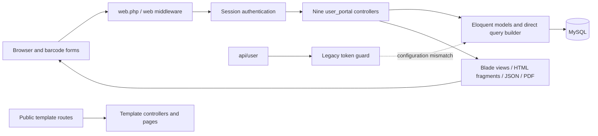

# Galaxy ERP — Module Map

> Audit date: **2026-11-05**, Asia/Karachi. This is a read-only application audit of the current working tree, including pre-existing uncommitted branding/table changes. Only these audit documents were created. No improvements described here are implemented or authorized by this report.

[Project Overview](PROJECT_OVERVIEW.md) | [Module Map](MODULE_MAP.md) | [Database Relationships](DATABASE_RELATIONSHIPS.md) | [Workflow Map](WORKFLOW_MAP.md) | [Ui Ux Audit](UI_UX_AUDIT.md) | [Security Audit](SECURITY_AUDIT.md) | [Performance Audit](PERFORMANCE_AUDIT.md) | [Improvement Roadmap](IMPROVEMENT_ROADMAP.md)

## Architecture and request flow

There is no application domain-service, repository, policy, FormRequest, queue-job, stock-event, or reconciliation layer in the inspected source. This is an architectural observation, not a requirement to add every pattern. Small services at posting boundaries are justified by STK-01 and ARCH-01; additional abstraction should follow a tested need.

## Business module ownership

| Module | Controller and key methods | Models | Principal views / connections |
|---|---|---|---|
| Login | `LoginController::getLogin/userLogin`, `IndexController::logout` | User, roles | login; menu role gates; session web guard |
| Users/master data | `UserController::saveUser/updateUser/updateUserPassword` and company/power/error/accessory CRUD | User, roles, Company, Power, ErrorInfo, Accessories | User, Company, Power, Error, Accessory directories |
| Dashboard | `IndexController::index` | ItemHistory, lookup masters, ItemHistoryAccessory | index; aggregate counts and chart variables |
| Repairs/service | `IndexController::searchMachineResult/saveNewMachineInfo/saveMachineInfo/saveExitMachine/markAsPacked` | ItemList, ItemHistory, ItemHistoryAccessory | Item views; warranty-check; slips and service reports |
| Raw-material stock | `RawMaterialController::saveRawMaterial/saveInventory/saveTransitInventory` | RawMaterial, RawMaterialInventory, TransitMethod | Inventory/raw material |
| Semi/finished production | `RawMaterialController::saveSemiRawMaterialRecipe/saveFinishedGoodsRecipe/saveSemiRawMaterialProduction/saveFinishedGoodsProduction` | SemiRawMaterial, FinishedGoods, recipe/inventory models | Inventory/semi raw material; Inventory/finished goods |
| Unit master | `UnitController::index/create/saveUnit` | Unit | Inventory/unit; no stock-unit relationship |
| UPS manufacturing | `ModelController::saveUpsModel/saveUpsModelRecipe/addFinishedUpsModel/addInCompleteUpsModelNew/saveRemainigInventoryNew` | UPSModel, ModelRecipe, FinishedModels, FinishedModelMaterial, RawMaterial | Inventory/model; retained old/new handlers |
| Machine testing | `MachineTestingController::saveTesting/saveAssignUnit/viewTestingList` | MachineTesting, User | MachineTesting views; board barcode to unit barcode |
| Dispatch serialization | `SerializationController::saveSerialization/addSerialization/serializationList` | Serialization, UPSModel | Serialization/create-new and index; stores model as string |
| Product/bundle inventory | `QuickBookController::productService/saveTransitInventoryNew/markReceivedTransitNew/updateBundleProducts` | Products, ProductInventory, Bundle, ProductCategory, ProductAsset, IncomeAccount, ExpenseAccount | New/products, categories, transit, received-transit, bundle editor |
| Customers | `QuickBookController::getCustomer/saveCustomer` | Customer | New/customers; not FK-linked to invoices/service |
| Estimates/planning | `QuickBookController::getProductEstimates/saveProductEstimates/deleteEstimate/productEstimatesCalculation` | ProductEstimate, EstimateValue, Bundle, Products | New/create-estimate, estimates, estimates-calculation, downloads |
| Invoices/issues | `QuickBookController::getInvoice/saveInvoice/SingleInvoiceDownload` | Invoice, InvoiceDetails, Products, Bundle, ProductInventory | New/invoice-new, invoice-download; quantity issue rather than finance posting |
| Legacy finished sales | `RawMaterialController::saveFinishedGoodsSale/viewFinishedGoodsSale` | FinishedGoodsOut, FinishedGoods | Inventory/sale, finished goods/view-sale |
| Reporting | `IndexController::reporting/customMachineDataPDF/downloadMachineData`, `QuickBookController::inventoryReport` | Query-builder joins and related models | reporting, Report, Item slips, New print templates |

## Existing role presentation matrix

This is a transcription of **menu visibility**, not an approved permission model. The corresponding server permissions are missing (SEC-02).

| Menu category | Numeric role IDs shown |
|---|---|
| Admin/master data, serialization, machine search | 1, 3, 5 |
| Testing list | 1, 2, 3, 5 |
| Start testing | 2 |
| Reports and raw/manufacturing inventory | 1, 3, 5 |
| Product inventory | 1, 4, 5 |
| Dashboard/logout | Any authenticated user |

`MachineTestingController::viewTestingList` filters test records to the current tester only for role 2; other roles receive all test rows if they call the route. RoleSeeder supplies admin/marketing/accounts/supply-chain/factory-agent labels, but the ID-to-responsibility mapping must be verified with the owner instead of inferring tester permissions from those labels. No tenant or company-scoped authorization boundary is defined; the Company master currently describes service/product affiliations, not a proven tenant model.

## Duplicate and retirement inventory

| Candidate | Evidence and status | Decision needed |
|---|---|---|
| `app/Http/Controllers/Controller copy.php` | Byte-identical to Controller.php, same declared class | Duplicate file, not a second domain abstraction; retain until reviewed cleanup |
| `ModelController::markCompleteUpsModel` and `markCompleteUpsModelNew` | Identical completion bodies | Determine legacy clients, then consolidate |
| `fetchInCompleteModelRecipe` and `fetchInCompleteModelRecipeNew` | Same read/view behavior | Preserve route contracts before deprecation |
| `addInCompleteUpsModel` versus `addInCompleteUpsModelNew` | Similar shape but consumed-vs-remaining input meaning differs | Do **not** merge as equivalent |
| `saveRemainigInventory` versus `saveRemainigInventoryNew` | Same naming/structure, different quantity contract | Shared posting core needs explicit adapter contracts |
| `productEstimatesCalculation` and `downloadProductEstimatesCalculation` | Duplicated parent/detail iteration and arithmetic | Share approved read model |
| `customMachineDataPDF` | Eight duplicated filter branches | Unified filters require eight-combination regression tests |
| `getInvoice` | First paginated query set discarded | PERF-04 |
| Theme/example controllers and 107 `resources/views/pages` templates | Registered demo routes remain outside auth | Many are reachable; “unused” is **not** established from their sample contents |
| `IndexController::count_order` | No registered route and no direct application caller found | Low-priority unused-helper candidate |
| `HomeController::index` | No registered route, missing literal `home` view | Dormant scaffold candidate |
| `addFinishedGoodsSale` GET page | No current literal UI caller found in scoped source | Direct URL/bookmark usage unknown; POST save route must not be removed independently |

Source-unreferenced template candidates (not proof of runtime non-use):

- `user_portal/New/invoice.blade.php` (active list uses invoice-new).
- `user_portal/New/sales.blade.php`.
- `user_portal/Serialization/create.blade.php` (controller selects create-new).
- `user_portal/welcome.blade.php`.
- `user_portal/layout/master.blade.php` and its header/sidebar/footer components; the master uses missing `layout.components.*` instead of its actual prefixed paths.
- `auth/passwords/confirm.blade.php`, `auth/verify.blade.php`, and `errors/403.blade.php`: framework-convention or implicit rendering may apply; do not classify as definitely dead.

`layouts/horizontalLayoutMaster` and `verticalLayoutMaster` are selected dynamically and **are used**, despite no literal include match. The `get-category`, `get-asset`, account lookup/save, and product lookup routes have consumers in handwritten `public/New/script.js`; absence of named route() calls is not unused-route evidence. API `/api/user` has no found frontend caller but external consumers remain possible. No routes, templates, packages, or classes were deleted.

## Business method and view inventory

Each method is linked to its current source line. Route presence does not establish usage frequency. `—` means no registered controller route for that method. Static view extraction does not include framework-convention/dynamic rendering.

### IndexController.php

| Method | Registered routes | Literal views returned |
|---|---|---|
| [index](../app/Http/Controllers/user_portal/IndexController.php#L23) | `GET|HEAD //`; `GET|HEAD /dashboard` | `user_portal.index` |
| [count_order](../app/Http/Controllers/user_portal/IndexController.php#L114) | — | — |
| [logout](../app/Http/Controllers/user_portal/IndexController.php#L119) | `GET|HEAD /user-logout` | — |
| [searchMachine](../app/Http/Controllers/user_portal/IndexController.php#L125) | `GET|HEAD /search-machine` | `user_portal.Item.check-item` |
| [searchMachineResult](../app/Http/Controllers/user_portal/IndexController.php#L134) | `POST /search-machine-result` | — |
| [addNewMachineInfo](../app/Http/Controllers/user_portal/IndexController.php#L148) | `GET|HEAD /add-new-machine-info/{serial_number}` | `user_portal.Item.create-machine` |
| [saveNewMachineInfo](../app/Http/Controllers/user_portal/IndexController.php#L164) | `POST /save-new-machine-info` | — |
| [fetchMachineDetails](../app/Http/Controllers/user_portal/IndexController.php#L258) | `GET|HEAD /fetch-machine-details/{id}` | `user_portal.Item.machine-history` |
| [addMachineInfo](../app/Http/Controllers/user_portal/IndexController.php#L274) | `GET|HEAD /add-machine-info/{id}` | `user_portal.Item.add-machine-info` |
| [saveMachineInfo](../app/Http/Controllers/user_portal/IndexController.php#L291) | `POST /save-machine-info` | — |
| [markAsPacked](../app/Http/Controllers/user_portal/IndexController.php#L363) | `GET|HEAD /mark-as-packed/{id}` | — |
| [exitMachine](../app/Http/Controllers/user_portal/IndexController.php#L371) | `GET|HEAD /exit-machine/{id}` | `user_portal.Item.exit` |
| [saveExitMachine](../app/Http/Controllers/user_portal/IndexController.php#L383) | `POST /save-exit-machine/{id}` | — |
| [reporting](../app/Http/Controllers/user_portal/IndexController.php#L416) | `GET|HEAD /reporting` | `user_portal.reporting` |
| [downloadMachineData](../app/Http/Controllers/user_portal/IndexController.php#L454) | `GET|HEAD /reporting-download` | `user_portal.download-reporting` |
| [machineList](../app/Http/Controllers/user_portal/IndexController.php#L471) | `GET|HEAD /machine-list` | `user_portal.Item.machine-list` |
| [printSlip](../app/Http/Controllers/user_portal/IndexController.php#L499) | `POST /print-machine-slip` | `user_portal.Item.machine-slip` |
| [singlePrintSlip](../app/Http/Controllers/user_portal/IndexController.php#L506) | `GET|HEAD /print-single-machine-slip/{id}` | `user_portal.Item.single-machine-slip` |
| [singleBarcodePrintSlip](../app/Http/Controllers/user_portal/IndexController.php#L512) | `GET|HEAD /barcode-print-single-machine-slip/{id}` | `user_portal.Item.barcode-machine-slip` |
| [overallPending](../app/Http/Controllers/user_portal/IndexController.php#L518) | `GET|HEAD /pending-overall-complains` | `user_portal.Report.pending` |
| [monthlyPending](../app/Http/Controllers/user_portal/IndexController.php#L530) | `GET|HEAD /pending-monthly-complains` | `user_portal.Report.pending` |
| [overallComplete](../app/Http/Controllers/user_portal/IndexController.php#L549) | `GET|HEAD /resolved-overall-complains` | `user_portal.Report.complete` |
| [monthlyComplete](../app/Http/Controllers/user_portal/IndexController.php#L561) | `GET|HEAD /resolved-monthly-complains` | `user_portal.Report.complete` |
| [customMachineData](../app/Http/Controllers/user_portal/IndexController.php#L580) | `GET|HEAD /custom-machine-report` | `user_portal.Report.custom-machine-report` |
| [customMachineDataPDF](../app/Http/Controllers/user_portal/IndexController.php#L594) | `POST /custom-machine-report-pdf` | `user_portal.Report.custom-machine-report-download` |
| [createNewMachineInfo](../app/Http/Controllers/user_portal/IndexController.php#L818) | `GET|HEAD /create-custom-machine-data` | `user_portal.Machine.create` |
| [saveNewCreateMachineInfo](../app/Http/Controllers/user_portal/IndexController.php#L830) | `POST /save-custom-machine-data` | — |
| [customMachineList](../app/Http/Controllers/user_portal/IndexController.php#L855) | `GET|HEAD /custom-machine-list` | `user_portal.Machine.index` |
| [warrantyCheck](../app/Http/Controllers/user_portal/IndexController.php#L867) | `POST /warranty-check` | — |
| [editMachine](../app/Http/Controllers/user_portal/IndexController.php#L888) | `GET|HEAD /edit-machine/{id}` | `user_portal.Item.edit-machine-info` |
| [saveEditMachine](../app/Http/Controllers/user_portal/IndexController.php#L906) | `POST /save-edit-machine/{id}` | — |
| [printThreeSlip](../app/Http/Controllers/user_portal/IndexController.php#L932) | `GET|HEAD /print-slip/{id}` | `user_portal.Item.print-slip` |

### LoginController.php

| Method | Registered routes | Literal views returned |
|---|---|---|
| [getLogin](../app/Http/Controllers/user_portal/LoginController.php#L14) | `GET|HEAD /login` | `user_portal.login` |
| [userLogin](../app/Http/Controllers/user_portal/LoginController.php#L19) | `POST /userLogin` | — |

### MachineTestingController.php

| Method | Registered routes | Literal views returned |
|---|---|---|
| [viewTesting](../app/Http/Controllers/user_portal/MachineTestingController.php#L15) | `GET|HEAD /view-testing-form` | `user_portal.MachineTesting.testing-form` |
| [saveTesting](../app/Http/Controllers/user_portal/MachineTestingController.php#L24) | `POST /save-testing-form` | — |
| [viewTestingList](../app/Http/Controllers/user_portal/MachineTestingController.php#L87) | `GET|HEAD /view-testing-list` | `user_portal.MachineTesting.view-testing-list` |
| [assignUnit](../app/Http/Controllers/user_portal/MachineTestingController.php#L106) | `GET|HEAD /assign-unit` | `user_portal.MachineTesting.assign-unit` |
| [saveAssignUnit](../app/Http/Controllers/user_portal/MachineTestingController.php#L115) | `POST /save-assign-unit` | — |

### ModelController.php

| Method | Registered routes | Literal views returned |
|---|---|---|
| [upsModel](../app/Http/Controllers/user_portal/ModelController.php#L17) | `GET|HEAD /ups-model-list` | `user_portal.Inventory.model.index` |
| [createUpsModel](../app/Http/Controllers/user_portal/ModelController.php#L27) | `GET|HEAD /create-ups-model` | `user_portal.Inventory.model.create` |
| [saveUpsModel](../app/Http/Controllers/user_portal/ModelController.php#L36) | `POST /save-ups-model` | — |
| [editUpsModel](../app/Http/Controllers/user_portal/ModelController.php#L56) | `GET|HEAD /edit-ups-model/{id}` | `user_portal.Inventory.model.edit` |
| [updateUpsModel](../app/Http/Controllers/user_portal/ModelController.php#L66) | `POST /update-ups-model` | — |
| [addUpsModelRecipe](../app/Http/Controllers/user_portal/ModelController.php#L84) | `GET|HEAD /add-ups-model-recipe/{id}` | `user_portal.Inventory.model.recipe` |
| [saveUpsModelRecipe](../app/Http/Controllers/user_portal/ModelController.php#L96) | `POST /save-ups-model-recipe` | — |
| [createFinishedUpsModel](../app/Http/Controllers/user_portal/ModelController.php#L138) | `GET|HEAD /create-finished-ups-model` | `user_portal.Inventory.model.finished_models.create` |
| [addFinishedUpsModel](../app/Http/Controllers/user_portal/ModelController.php#L148) | `POST /add-finished-ups-model` | — |
| [finishedUpsModelList](../app/Http/Controllers/user_portal/ModelController.php#L258) | `GET|HEAD /finished-ups-model-list` | `user_portal.Inventory.model.finished_models.index` |
| [inCompleteUpsModelList](../app/Http/Controllers/user_portal/ModelController.php#L268) | `GET|HEAD /in-complete-ups-model-list` | `user_portal.Inventory.model.in_complete_models.index` |
| [selectModel](../app/Http/Controllers/user_portal/ModelController.php#L278) | `GET|HEAD /select-model` | `user_portal.Inventory.model.in_complete_models.create` |
| [fetchModelRecipe](../app/Http/Controllers/user_portal/ModelController.php#L288) | `POST /fetch-model-recipe` | `user_portal.Inventory.model.in_complete_models.model_recipe` |
| [addInCompleteUpsModel](../app/Http/Controllers/user_portal/ModelController.php#L301) | `POST /add-in-complete-ups-model` | — |
| [markCompleteUpsModel](../app/Http/Controllers/user_portal/ModelController.php#L414) | `GET|HEAD /mark-complete-ups-model/{id}` | — |
| [fetchInCompleteModelRecipe](../app/Http/Controllers/user_portal/ModelController.php#L460) | `GET|HEAD /fetch-in-complete-ups-model/{id}` | `user_portal.Inventory.model.in_complete_models.complete` |
| [saveRemainigInventory](../app/Http/Controllers/user_portal/ModelController.php#L473) | `POST /saveRemainigInventory` | — |
| [checkModelProduction](../app/Http/Controllers/user_portal/ModelController.php#L521) | `GET|HEAD /check-model-production/{id}` | `user_portal.Inventory.model.check` |
| [getModelProduction](../app/Http/Controllers/user_portal/ModelController.php#L531) | `POST /get-model-production` | — |
| [addInCompleteUpsModelNew](../app/Http/Controllers/user_portal/ModelController.php#L593) | `POST /add-in-complete-ups-model-new` | — |
| [markCompleteUpsModelNew](../app/Http/Controllers/user_portal/ModelController.php#L711) | `GET|HEAD /mark-complete-ups-model-new/{id}` | — |
| [fetchInCompleteModelRecipeNew](../app/Http/Controllers/user_portal/ModelController.php#L757) | `GET|HEAD /fetch-in-complete-ups-model-new/{id}` | `user_portal.Inventory.model.in_complete_models.complete` |
| [saveRemainigInventoryNew](../app/Http/Controllers/user_portal/ModelController.php#L770) | `POST /saveRemainigInventoryNew` | — |

### QuickBookController.php

| Method | Registered routes | Literal views returned |
|---|---|---|
| [productService](../app/Http/Controllers/user_portal/QuickBookController.php#L30) | `GET|HEAD /product-services` | `user_portal.New.products` |
| [inTransitInventory](../app/Http/Controllers/user_portal/QuickBookController.php#L233) | `GET|HEAD /in-transit-inventory` | `user_portal.New.transit` |
| [receivedTransitInventory](../app/Http/Controllers/user_portal/QuickBookController.php#L249) | `GET|HEAD /received-transit-inventory` | `user_portal.New.received-transit` |
| [saveTransitInventoryNew](../app/Http/Controllers/user_portal/QuickBookController.php#L258) | `POST /save-transit-inventory-new` | — |
| [markReceivedTransit](../app/Http/Controllers/user_portal/QuickBookController.php#L326) | `GET|HEAD /mark-received-transit/{id}` | — |
| [markReceivedTransitNew](../app/Http/Controllers/user_portal/QuickBookController.php#L351) | `POST /mark-received-transit-new` | — |
| [saveProductCategory](../app/Http/Controllers/user_portal/QuickBookController.php#L394) | `POST /save-product-category` | — |
| [getCategory](../app/Http/Controllers/user_portal/QuickBookController.php#L406) | `GET|HEAD /get-category` | — |
| [saveProductAsset](../app/Http/Controllers/user_portal/QuickBookController.php#L423) | `POST /save-product-asset` | — |
| [getAsset](../app/Http/Controllers/user_portal/QuickBookController.php#L435) | `GET|HEAD /get-asset` | — |
| [saveIncomeAccount](../app/Http/Controllers/user_portal/QuickBookController.php#L452) | `POST /save-income-account` | — |
| [getIncomeAccount](../app/Http/Controllers/user_portal/QuickBookController.php#L464) | `GET|HEAD /get-income-account` | — |
| [saveExpenseAccount](../app/Http/Controllers/user_portal/QuickBookController.php#L481) | `POST /save-expense-account` | — |
| [getExpenseAccount](../app/Http/Controllers/user_portal/QuickBookController.php#L493) | `GET|HEAD /get-expense-account` | — |
| [getProductService](../app/Http/Controllers/user_portal/QuickBookController.php#L510) | `GET|HEAD /get-product-service` | — |
| [getCustomer](../app/Http/Controllers/user_portal/QuickBookController.php#L527) | `GET|HEAD /get-customer` | `user_portal.New.customers` |
| [saveCustomer](../app/Http/Controllers/user_portal/QuickBookController.php#L533) | `POST /save-customer` | — |
| [productEstimates](../app/Http/Controllers/user_portal/QuickBookController.php#L570) | `GET|HEAD /product-estimates` | `user_portal.New.estimates` |
| [createProductEstimates](../app/Http/Controllers/user_portal/QuickBookController.php#L576) | `GET|HEAD /create-product-estimates` | `user_portal.New.create-estimate` |
| [getProductEstimates](../app/Http/Controllers/user_portal/QuickBookController.php#L598) | `POST /get-product-estimates` | — |
| [saveProductEstimates](../app/Http/Controllers/user_portal/QuickBookController.php#L660) | `POST /save-product-estimates` | — |
| [SingleEstimateDownload](../app/Http/Controllers/user_portal/QuickBookController.php#L733) | `GET|HEAD /print-single-estimate/{id}` | `user_portal.New.estimate-download` |
| [productEstimatesCalculation](../app/Http/Controllers/user_portal/QuickBookController.php#L742) | `GET|HEAD /product-estimates-calculation` | `user_portal.New.estimates-calculation` |
| [downloadProductEstimatesCalculation](../app/Http/Controllers/user_portal/QuickBookController.php#L785) | `GET|HEAD /download-product-estimates-calculation` | `user_portal.New.download-calculation` |
| [deleteEstimate](../app/Http/Controllers/user_portal/QuickBookController.php#L828) | `GET|HEAD /delete-estimate/{id}` | — |
| [getInvoice](../app/Http/Controllers/user_portal/QuickBookController.php#L849) | `GET|HEAD /get-invoice` | `user_portal.New.invoice-new` |
| [saveInvoice](../app/Http/Controllers/user_portal/QuickBookController.php#L890) | `POST /save-invoice` | — |
| [SingleInvoiceDownload](../app/Http/Controllers/user_portal/QuickBookController.php#L982) | `GET|HEAD /print-single-invoice/{id}` | `user_portal.New.invoice-download` |
| [getInvoiceProductService](../app/Http/Controllers/user_portal/QuickBookController.php#L988) | `GET|HEAD /get-invoice-product-service` | — |
| [getProductQuantity](../app/Http/Controllers/user_portal/QuickBookController.php#L1005) | `GET|HEAD /get-product-quantity/{id}` | — |
| [inventoryReport](../app/Http/Controllers/user_portal/QuickBookController.php#L1030) | `GET|HEAD /inventory-ledger/{id}` | `user_portal.New.inventory-report-download` |
| [updateProductInfo](../app/Http/Controllers/user_portal/QuickBookController.php#L1036) | `POST /update-product-info` | — |
| [deleteProduct](../app/Http/Controllers/user_portal/QuickBookController.php#L1057) | `GET|HEAD /delete-product/{id}` | — |
| [activeProduct](../app/Http/Controllers/user_portal/QuickBookController.php#L1065) | `GET|HEAD /active-product/{id}` | — |
| [lowStockProducts](../app/Http/Controllers/user_portal/QuickBookController.php#L1074) | `GET|HEAD /low-stock-products` | `user_portal.New.low-stock` |
| [outStockProducts](../app/Http/Controllers/user_portal/QuickBookController.php#L1088) | `GET|HEAD /out-stock-products` | `user_portal.New.low-stock` |
| [productCategories](../app/Http/Controllers/user_portal/QuickBookController.php#L1100) | `GET|HEAD /product-categories` | `user_portal.New.categories` |
| [deleteCategory](../app/Http/Controllers/user_portal/QuickBookController.php#L1119) | `GET|HEAD /delete-category/{id}` | — |
| [activeCategory](../app/Http/Controllers/user_portal/QuickBookController.php#L1127) | `GET|HEAD /active-category/{id}` | — |
| [editBundleProducts](../app/Http/Controllers/user_portal/QuickBookController.php#L1135) | `GET|HEAD /edit-bundle-products/{id}` | `user_portal.New.edit-bundle-products` |
| [updateBundleProducts](../app/Http/Controllers/user_portal/QuickBookController.php#L1149) | `POST /update-bundle-products/{id}` | — |

### RawMaterialController.php

| Method | Registered routes | Literal views returned |
|---|---|---|
| [rawMaterial](../app/Http/Controllers/user_portal/RawMaterialController.php#L25) | `GET|HEAD /raw-items-list` | `user_portal.Inventory.raw material.index` |
| [createRawMaterial](../app/Http/Controllers/user_portal/RawMaterialController.php#L35) | `GET|HEAD /create-raw-material` | `user_portal.Inventory.raw material.create` |
| [saveRawMaterial](../app/Http/Controllers/user_portal/RawMaterialController.php#L44) | `POST /save-raw-material` | — |
| [editMaterial](../app/Http/Controllers/user_portal/RawMaterialController.php#L61) | `GET|HEAD /edit-material/{id}` | `user_portal.Inventory.raw material.edit` |
| [updateRawMaterial](../app/Http/Controllers/user_portal/RawMaterialController.php#L71) | `POST /update-material` | — |
| [addInventory](../app/Http/Controllers/user_portal/RawMaterialController.php#L87) | `GET|HEAD /add-inventory/{id}` | `user_portal.Inventory.raw material.add-inventory` |
| [saveInventory](../app/Http/Controllers/user_portal/RawMaterialController.php#L98) | `POST /save-inventory` | — |
| [viewInventory](../app/Http/Controllers/user_portal/RawMaterialController.php#L143) | `GET|HEAD /view-inventory/{id}` | `user_portal.Inventory.raw material.view-inventory` |
| [semiRawMaterial](../app/Http/Controllers/user_portal/RawMaterialController.php#L155) | `GET|HEAD /semi-raw-items-list` | `user_portal.Inventory.semi raw material.index` |
| [createSemiRawMaterial](../app/Http/Controllers/user_portal/RawMaterialController.php#L165) | `GET|HEAD /create-semi-raw-material` | `user_portal.Inventory.semi raw material.create` |
| [saveSemiRawMaterial](../app/Http/Controllers/user_portal/RawMaterialController.php#L174) | `POST /save-semi-raw-material` | — |
| [editSemiRawMaterial](../app/Http/Controllers/user_portal/RawMaterialController.php#L191) | `GET|HEAD /edit-semi-raw-material/{id}` | `user_portal.Inventory.semi raw material.edit` |
| [updateSemiRawMaterial](../app/Http/Controllers/user_portal/RawMaterialController.php#L201) | `POST /update-semi-raw-material` | — |
| [finishedGoodsList](../app/Http/Controllers/user_portal/RawMaterialController.php#L219) | `GET|HEAD /finished-goods-list` | `user_portal.Inventory.finished goods.index` |
| [createFinishedGoods](../app/Http/Controllers/user_portal/RawMaterialController.php#L229) | `GET|HEAD /create-finished-goods` | `user_portal.Inventory.finished goods.create` |
| [saveFinishedGoods](../app/Http/Controllers/user_portal/RawMaterialController.php#L238) | `POST /save-finished-goods` | — |
| [editFinishedGoods](../app/Http/Controllers/user_portal/RawMaterialController.php#L255) | `GET|HEAD /edit-finished-goods/{id}` | `user_portal.Inventory.finished goods.edit` |
| [updateFinishedGoods](../app/Http/Controllers/user_portal/RawMaterialController.php#L265) | `POST /update-finished-goods` | — |
| [addSemiRawMaterialRecipe](../app/Http/Controllers/user_portal/RawMaterialController.php#L283) | `GET|HEAD /add-semi-raw-material-recipe/{id}` | `user_portal.Inventory.semi raw material.create-recipe` |
| [saveSemiRawMaterialRecipe](../app/Http/Controllers/user_portal/RawMaterialController.php#L295) | `POST /save-semi-raw-material-recipe` | — |
| [addFinishedGoodsRecipe](../app/Http/Controllers/user_portal/RawMaterialController.php#L339) | `GET|HEAD /add-finished-goods-recipe/{id}` | `user_portal.Inventory.finished goods.create-recipe` |
| [saveFinishedGoodsRecipe](../app/Http/Controllers/user_portal/RawMaterialController.php#L352) | `POST /save-finished-goods-recipe` | — |
| [addSemiRawMaterialProduction](../app/Http/Controllers/user_portal/RawMaterialController.php#L415) | `GET|HEAD /add-semi-raw-material-production/{id}` | `user_portal.Inventory.semi raw material.production` |
| [getSemiRawMaterialProduction](../app/Http/Controllers/user_portal/RawMaterialController.php#L425) | `POST /get-semi-raw-material-production` | — |
| [saveSemiRawMaterialProduction](../app/Http/Controllers/user_portal/RawMaterialController.php#L488) | `POST /save-semi-raw-material-production` | — |
| [viewSemiRawMaterialProduction](../app/Http/Controllers/user_portal/RawMaterialController.php#L533) | `GET|HEAD /view-semi-raw-material-production/{id}` | `user_portal.Inventory.semi raw material.view-production` |
| [addFinishedGoodsProduction](../app/Http/Controllers/user_portal/RawMaterialController.php#L546) | `GET|HEAD /add-finished-goods-production/{id}` | `user_portal.Inventory.finished goods.production` |
| [getFinishedGoodsProduction](../app/Http/Controllers/user_portal/RawMaterialController.php#L556) | `POST /get-finished-goods-production` | — |
| [saveFinishedGoodsProduction](../app/Http/Controllers/user_portal/RawMaterialController.php#L658) | `POST /save-finished-goods-production` | — |
| [viewFinishedGoodsProduction](../app/Http/Controllers/user_portal/RawMaterialController.php#L722) | `GET|HEAD /view-finished-goods-production/{id}` | `user_portal.Inventory.finished goods.view-production` |
| [addFinishedGoodsSale](../app/Http/Controllers/user_portal/RawMaterialController.php#L735) | `GET|HEAD /add-finished-goods-sales` | `user_portal.Inventory.sale` |
| [saveFinishedGoodsSale](../app/Http/Controllers/user_portal/RawMaterialController.php#L748) | `POST /save-finished-goods-sales` | — |
| [viewFinishedGoodsSale](../app/Http/Controllers/user_portal/RawMaterialController.php#L788) | `GET|HEAD /view-finished-goods-sales/{id}` | `user_portal.Inventory.finished goods.view-sale` |
| [viewTransitInventory](../app/Http/Controllers/user_portal/RawMaterialController.php#L801) | `GET|HEAD /view-transit-inventory` | `user_portal.Inventory.raw material.view-transit-inventory` |
| [saveTransitInventory](../app/Http/Controllers/user_portal/RawMaterialController.php#L811) | `GET|HEAD /save-transit-inventory/{id}` | — |

### SerializationController.php

| Method | Registered routes | Literal views returned |
|---|---|---|
| [serializationList](../app/Http/Controllers/user_portal/SerializationController.php#L14) | `GET|HEAD /serialization-list` | `user_portal.Serialization.index` |
| [createSerialization](../app/Http/Controllers/user_portal/SerializationController.php#L24) | `GET|HEAD /create-serialization-data` | `user_portal.Serialization.create-new` |
| [saveSerialization](../app/Http/Controllers/user_portal/SerializationController.php#L36) | `POST /save-serialization-data` | — |
| [addSerialization](../app/Http/Controllers/user_portal/SerializationController.php#L74) | `POST /add-serialization` | — |

### UnitController.php

| Method | Registered routes | Literal views returned |
|---|---|---|
| [index](../app/Http/Controllers/user_portal/UnitController.php#L12) | `GET|HEAD /unit-list` | `user_portal.Inventory.unit.index` |
| [create](../app/Http/Controllers/user_portal/UnitController.php#L22) | `GET|HEAD /create-new-unit` | `user_portal.Inventory.unit.create` |
| [saveUnit](../app/Http/Controllers/user_portal/UnitController.php#L31) | `POST /save-new-unit` | — |

### UserController.php

| Method | Registered routes | Literal views returned |
|---|---|---|
| [createUser](../app/Http/Controllers/user_portal/UserController.php#L18) | `GET|HEAD /create-user` | `user_portal.User.create-new-user` |
| [saveUser](../app/Http/Controllers/user_portal/UserController.php#L28) | `POST /save-users` | — |
| [UserList](../app/Http/Controllers/user_portal/UserController.php#L50) | `GET|HEAD /users` | `user_portal.User.user_list` |
| [editUser](../app/Http/Controllers/user_portal/UserController.php#L60) | `GET|HEAD /edit-user/{id}` | `user_portal.User.edit-new-user` |
| [updateUser](../app/Http/Controllers/user_portal/UserController.php#L71) | `POST /update-user/{id}` | — |
| [updatePassword](../app/Http/Controllers/user_portal/UserController.php#L90) | `GET|HEAD /edit-user-password/{id}` | `user_portal.User.edit-password` |
| [updateUserPassword](../app/Http/Controllers/user_portal/UserController.php#L100) | `POST /update-user-password` | — |
| [createCompany](../app/Http/Controllers/user_portal/UserController.php#L116) | `GET|HEAD /create-company` | `user_portal.Company.create` |
| [saveCompany](../app/Http/Controllers/user_portal/UserController.php#L125) | `POST /save-company` | — |
| [CompanyList](../app/Http/Controllers/user_portal/UserController.php#L142) | `GET|HEAD /company-list` | `user_portal.Company.index` |
| [editCompany](../app/Http/Controllers/user_portal/UserController.php#L152) | `GET|HEAD /edit-company/{id}` | `user_portal.Company.edit` |
| [updateCompany](../app/Http/Controllers/user_portal/UserController.php#L162) | `POST /update-company/{id}` | — |
| [createPower](../app/Http/Controllers/user_portal/UserController.php#L181) | `GET|HEAD /create-power` | `user_portal.Power.create` |
| [savePower](../app/Http/Controllers/user_portal/UserController.php#L190) | `POST /save-power` | — |
| [PowerList](../app/Http/Controllers/user_portal/UserController.php#L206) | `GET|HEAD /power-list` | `user_portal.Power.index` |
| [editPower](../app/Http/Controllers/user_portal/UserController.php#L216) | `GET|HEAD /edit-power/{id}` | `user_portal.Power.edit` |
| [updatePower](../app/Http/Controllers/user_portal/UserController.php#L226) | `POST /update-power/{id}` | — |
| [createError](../app/Http/Controllers/user_portal/UserController.php#L244) | `GET|HEAD /create-error` | `user_portal.Error.create` |
| [saveError](../app/Http/Controllers/user_portal/UserController.php#L253) | `POST /save-error` | — |
| [ErrorList](../app/Http/Controllers/user_portal/UserController.php#L271) | `GET|HEAD /error-list` | `user_portal.Error.index` |
| [editError](../app/Http/Controllers/user_portal/UserController.php#L281) | `GET|HEAD /edit-error/{id}` | `user_portal.Error.edit` |
| [updateError](../app/Http/Controllers/user_portal/UserController.php#L291) | `POST /update-error/{id}` | — |
| [createAccessory](../app/Http/Controllers/user_portal/UserController.php#L311) | `GET|HEAD /create-accessory` | `user_portal.Accessory.create` |
| [saveAccessory](../app/Http/Controllers/user_portal/UserController.php#L320) | `POST /save-accessory` | — |
| [AccessoryList](../app/Http/Controllers/user_portal/UserController.php#L337) | `GET|HEAD /accessory-list` | `user_portal.Accessory.index` |
| [editAccessory](../app/Http/Controllers/user_portal/UserController.php#L347) | `GET|HEAD /edit-accessory/{id}` | `user_portal.Accessory.edit` |
| [updateAccessory](../app/Http/Controllers/user_portal/UserController.php#L357) | `POST /update-accessory/{id}` | — |

## Registered route catalog

Read-only output of the loaded route registry. This includes template/demo routes; it does not assert that they are used. Closure locations are in routes/web.php except `/api/user` in routes/api.php. No route cache was generated and no operational mutation endpoint was called.

| Method | URI | Name | Action | Middleware |
|---|---|---|---|---|
| `GET / HEAD` | `//` | `index` | `user_portal\IndexController@index` | `web, auth` |
| `GET / HEAD` | `/accessory-list` | `AccessoryList` | `user_portal\UserController@AccessoryList` | `web, auth` |
| `GET / HEAD` | `/active-category/{id}` | `activeCategory` | `user_portal\QuickBookController@activeCategory` | `web, auth` |
| `GET / HEAD` | `/active-product/{id}` | `activeProduct` | `user_portal\QuickBookController@activeProduct` | `web, auth` |
| `GET / HEAD` | `/add-finished-goods-production/{id}` | `addFinishedGoodsProduction` | `user_portal\RawMaterialController@addFinishedGoodsProduction` | `web, auth` |
| `GET / HEAD` | `/add-finished-goods-recipe/{id}` | `addFinishedGoodsRecipe` | `user_portal\RawMaterialController@addFinishedGoodsRecipe` | `web, auth` |
| `GET / HEAD` | `/add-finished-goods-sales` | `addFinishedGoodsSale` | `user_portal\RawMaterialController@addFinishedGoodsSale` | `web, auth` |
| `POST` | `/add-finished-ups-model` | `add-finished-ups-model` | `user_portal\ModelController@addFinishedUpsModel` | `web, auth` |
| `POST` | `/add-in-complete-ups-model` | `add-in-complete-ups-model` | `user_portal\ModelController@addInCompleteUpsModel` | `web, auth` |
| `POST` | `/add-in-complete-ups-model-new` | `add-in-complete-ups-model-new` | `user_portal\ModelController@addInCompleteUpsModelNew` | `web, auth` |
| `GET / HEAD` | `/add-inventory/{id}` | `addInventory` | `user_portal\RawMaterialController@addInventory` | `web, auth` |
| `GET / HEAD` | `/add-machine-info/{id}` | `addMachineInfo` | `user_portal\IndexController@addMachineInfo` | `web, auth` |
| `GET / HEAD` | `/add-new-machine-info/{serial_number}` | `addNewMachineInfo` | `user_portal\IndexController@addNewMachineInfo` | `web, auth` |
| `GET / HEAD` | `/add-semi-raw-material-production/{id}` | `addSemiRawMaterialProduction` | `user_portal\RawMaterialController@addSemiRawMaterialProduction` | `web, auth` |
| `GET / HEAD` | `/add-semi-raw-material-recipe/{id}` | `addSemiRawMaterialRecipe` | `user_portal\RawMaterialController@addSemiRawMaterialRecipe` | `web, auth` |
| `POST` | `/add-serialization` | `add-serialization` | `user_portal\SerializationController@addSerialization` | `web, auth` |
| `GET / HEAD` | `/add-ups-model-recipe/{id}` | `addUpsModelRecipe` | `user_portal\ModelController@addUpsModelRecipe` | `web, auth` |
| `GET / HEAD` | `/api/user` | `generated::YIYemHPNRC0NQnii` | `Closure` | `api, auth:api` |
| `GET / HEAD` | `/app/calendar` | `app-calendar` | `ApplicationController@calendarApplication` | `web` |
| `GET / HEAD` | `/app/chat` | `app-chat` | `ApplicationController@chatApplication` | `web` |
| `GET / HEAD` | `/app/email` | `app-email` | `ApplicationController@emailApplication` | `web` |
| `GET / HEAD` | `/app/file-manager` | `app-file-manager` | `ApplicationController@fileManagerApplication` | `web` |
| `GET / HEAD` | `/app/invoice/add` | `app-invoice-add` | `ApplicationController@invoiceAddApplication` | `web` |
| `GET / HEAD` | `/app/invoice/edit` | `app-invoice-edit` | `ApplicationController@invoiceEditApplication` | `web` |
| `GET / HEAD` | `/app/invoice/list` | `app-invoice-list` | `ApplicationController@invoiceListApplication` | `web` |
| `GET / HEAD` | `/app/invoice/view` | `app-invoice-view` | `ApplicationController@invoiceApplication` | `web` |
| `GET / HEAD` | `/app/kanban` | `app-kanban` | `ApplicationController@kanbanApplication` | `web` |
| `GET / HEAD` | `/app/todo` | `app-todo` | `ApplicationController@todoApplication` | `web` |
| `GET / HEAD` | `/app/users/edit` | `app-users-edit` | `UsersController@editUser` | `web` |
| `GET / HEAD` | `/app/users/list` | `app-users-list` | `UsersController@listUser` | `web` |
| `GET / HEAD` | `/app/users/view` | `app-users-view` | `UsersController@viewUser` | `web` |
| `GET / HEAD` | `/assign-unit` | `assign-unit` | `user_portal\MachineTestingController@assignUnit` | `web, auth` |
| `GET / HEAD` | `/auth/forgot-password` | `auth-forgot-password` | `AuthenticationController@forgetPasswordPage` | `web` |
| `GET / HEAD` | `/auth/lock-screen` | `auth-lock-screen` | `AuthenticationController@authLockPage` | `web` |
| `GET / HEAD` | `/auth/login1` | `auth-login` | `AuthenticationController@loginPage` | `web` |
| `GET / HEAD` | `/auth/register` | `auth-register` | `AuthenticationController@registerPage` | `web` |
| `GET / HEAD` | `/auth/reset-password` | `auth-reset-password` | `AuthenticationController@resetPasswordPage` | `web` |
| `GET / HEAD` | `/barcode-print-single-machine-slip/{id}` | `singleBarcodePrintSlip` | `user_portal\IndexController@singleBarcodePrintSlip` | `web, auth` |
| `GET / HEAD` | `/card/actions` | `card-actions` | `CardController@actionCard` | `web` |
| `GET / HEAD` | `/card/basic` | `card-basic` | `CardController@basicCard` | `web` |
| `GET / HEAD` | `/card/widgets` | `card-widgets` | `CardController@widgets` | `web` |
| `GET / HEAD` | `/chart/apex` | `chart-apex` | `ChartController@apexChart` | `web` |
| `GET / HEAD` | `/chart/chartist` | `chart-chartist` | `ChartController@chartist` | `web` |
| `GET / HEAD` | `/chart/chartjs` | `chart-chartjs` | `ChartController@chartJs` | `web` |
| `GET / HEAD` | `/check-model-production/{id}` | `checkModelProduction` | `user_portal\ModelController@checkModelProduction` | `web, auth` |
| `GET / HEAD` | `/clear` | `generated::JRkup9knd7LtvpPH` | `Closure` | `web` |
| `GET / HEAD` | `/company-list` | `CompanyList` | `user_portal\UserController@CompanyList` | `web, auth` |
| `GET / HEAD` | `/component/alerts` | `component-alerts` | `ComponentController@alertComponenet` | `web` |
| `GET / HEAD` | `/component/badges` | `component-badges` | `ComponentController@badgesComponenet` | `web` |
| `GET / HEAD` | `/component/breadcrumbs` | `component-breadcrumbs` | `ComponentController@breadcrumbsComponenet` | `web` |
| `GET / HEAD` | `/component/bs-toast` | `component-bs-toast` | `ComponentController@toastsComponenet` | `web` |
| `GET / HEAD` | `/component/buttons-basic` | `component-buttons-basic` | `ComponentController@buttonComponenet` | `web` |
| `GET / HEAD` | `/component/carousel` | `component-carousel` | `ComponentController@carouselComponenet` | `web` |
| `GET / HEAD` | `/component/collapse` | `component-collapse` | `ComponentController@collapseComponenet` | `web` |
| `GET / HEAD` | `/component/dropdowns` | `component-dropdowns` | `ComponentController@dropdownComponenet` | `web` |
| `GET / HEAD` | `/component/list-group` | `component-list-group` | `ComponentController@listGroupComponenet` | `web` |
| `GET / HEAD` | `/component/media-objects` | `component-media-objects` | `ComponentController@mediaObjectComponenet` | `web` |
| `GET / HEAD` | `/component/modals` | `component-modals` | `ComponentController@modalComponenet` | `web` |
| `GET / HEAD` | `/component/navbar` | `component-navbar` | `ComponentController@navbarComponenet` | `web` |
| `GET / HEAD` | `/component/pagination` | `component-pagination` | `ComponentController@paginationComponenet` | `web` |
| `GET / HEAD` | `/component/pill-badges` | `component-pill-badges` | `ComponentController@pillBadgesComponenet` | `web` |
| `GET / HEAD` | `/component/pills-component` | `component-pills-component` | `ComponentController@pillComponenet` | `web` |
| `GET / HEAD` | `/component/popovers` | `component-popovers` | `ComponentController@popoversComponenet` | `web` |
| `GET / HEAD` | `/component/progress` | `component-progress` | `ComponentController@progressComponenet` | `web` |
| `GET / HEAD` | `/component/spinner` | `component-spinner` | `ComponentController@spinnerComponenet` | `web` |
| `GET / HEAD` | `/component/tabs-component` | `component-tabs-component` | `ComponentController@tabsComponenet` | `web` |
| `GET / HEAD` | `/component/tooltips` | `component-tooltips` | `ComponentController@tooltipsComponenet` | `web` |
| `GET / HEAD` | `/content/colors` | `content-colors` | `ContentController@colorContent` | `web` |
| `GET / HEAD` | `/content/grid` | `content-grid` | `ContentController@gridContent` | `web` |
| `GET / HEAD` | `/content/helper-classes` | `content-helper-classes` | `ContentController@contentHelperClasses` | `web` |
| `GET / HEAD` | `/content/syntax-highlighter` | `content-syntax-highlighter` | `ContentController@contentSyntaxHighlighter` | `web` |
| `GET / HEAD` | `/content/text-utilities` | `content-text-utilities` | `ContentController@textUtilitiesContent` | `web` |
| `GET / HEAD` | `/content/typography` | `content-typography` | `ContentController@typographyContent` | `web` |
| `GET / HEAD` | `/create-accessory` | `createAccessory` | `user_portal\UserController@createAccessory` | `web, auth` |
| `GET / HEAD` | `/create-company` | `createCompany` | `user_portal\UserController@createCompany` | `web, auth` |
| `GET / HEAD` | `/create-custom-machine-data` | `create-custom-machine-data` | `user_portal\IndexController@createNewMachineInfo` | `web, auth` |
| `GET / HEAD` | `/create-error` | `createError` | `user_portal\UserController@createError` | `web, auth` |
| `GET / HEAD` | `/create-finished-goods` | `create-finished-goods` | `user_portal\RawMaterialController@createFinishedGoods` | `web, auth` |
| `GET / HEAD` | `/create-finished-ups-model` | `create-finished-ups-model` | `user_portal\ModelController@createFinishedUpsModel` | `web, auth` |
| `GET / HEAD` | `/create-new-unit` | `create-new-unit` | `user_portal\UnitController@create` | `web, auth` |
| `GET / HEAD` | `/create-power` | `createPower` | `user_portal\UserController@createPower` | `web, auth` |
| `GET / HEAD` | `/create-product-estimates` | `createProductEstimates` | `user_portal\QuickBookController@createProductEstimates` | `web, auth` |
| `GET / HEAD` | `/create-raw-material` | `create-raw-material` | `user_portal\RawMaterialController@createRawMaterial` | `web, auth` |
| `GET / HEAD` | `/create-semi-raw-material` | `create-semi-raw-material` | `user_portal\RawMaterialController@createSemiRawMaterial` | `web, auth` |
| `GET / HEAD` | `/create-serialization-data` | `create-serialization-data` | `user_portal\SerializationController@createSerialization` | `web, auth` |
| `GET / HEAD` | `/create-ups-model` | `create-ups-model` | `user_portal\ModelController@createUpsModel` | `web, auth` |
| `GET / HEAD` | `/create-user` | `createUser` | `user_portal\UserController@createUser` | `web, auth` |
| `GET / HEAD` | `/custom-machine-list` | `custom-machine-list` | `user_portal\IndexController@customMachineList` | `web, auth` |
| `GET / HEAD` | `/custom-machine-report` | `custom-machine-report` | `user_portal\IndexController@customMachineData` | `web, auth` |
| `POST` | `/custom-machine-report-pdf` | `custom-machine-report-pdf` | `user_portal\IndexController@customMachineDataPDF` | `web, auth` |
| `GET / HEAD` | `/dashboard` | `dashboard` | `user_portal\IndexController@index` | `web, auth` |
| `GET / HEAD` | `/dashboard/analytics` | `dashboard-analytics` | `DashboardController@dashboardAnalytics` | `web` |
| `GET / HEAD` | `/dashboard/ecommerce` | `dashboard-ecommerce` | `DashboardController@dashboardEcommerce` | `web` |
| `GET / HEAD` | `/delete-category/{id}` | `deleteCategory` | `user_portal\QuickBookController@deleteCategory` | `web, auth` |
| `GET / HEAD` | `/delete-estimate/{id}` | `deleteEstimate` | `user_portal\QuickBookController@deleteEstimate` | `web, auth` |
| `GET / HEAD` | `/delete-product/{id}` | `deleteProduct` | `user_portal\QuickBookController@deleteProduct` | `web, auth` |
| `GET / HEAD` | `/download-product-estimates-calculation` | `downloadProductEstimatesCalculation` | `user_portal\QuickBookController@downloadProductEstimatesCalculation` | `web, auth` |
| `GET / HEAD` | `/ecommerce-dashboard` | `ecommerce-dashboard` | `DashboardController@dashboardEcommerce` | `web` |
| `GET / HEAD` | `/edit-accessory/{id}` | `editAccessory` | `user_portal\UserController@editAccessory` | `web, auth` |
| `GET / HEAD` | `/edit-bundle-products/{id}` | `editBundleProducts` | `user_portal\QuickBookController@editBundleProducts` | `web, auth` |
| `GET / HEAD` | `/edit-company/{id}` | `editCompany` | `user_portal\UserController@editCompany` | `web, auth` |
| `GET / HEAD` | `/edit-error/{id}` | `editError` | `user_portal\UserController@editError` | `web, auth` |
| `GET / HEAD` | `/edit-finished-goods/{id}` | `editFinishedGoods` | `user_portal\RawMaterialController@editFinishedGoods` | `web, auth` |
| `GET / HEAD` | `/edit-machine/{id}` | `editMachine` | `user_portal\IndexController@editMachine` | `web, auth` |
| `GET / HEAD` | `/edit-material/{id}` | `editMaterial` | `user_portal\RawMaterialController@editMaterial` | `web, auth` |
| `GET / HEAD` | `/edit-power/{id}` | `editPower` | `user_portal\UserController@editPower` | `web, auth` |
| `GET / HEAD` | `/edit-semi-raw-material/{id}` | `editSemiRawMaterial` | `user_portal\RawMaterialController@editSemiRawMaterial` | `web, auth` |
| `GET / HEAD` | `/edit-ups-model/{id}` | `editUpsModel` | `user_portal\ModelController@editUpsModel` | `web, auth` |
| `GET / HEAD` | `/edit-user-password/{id}` | `edit-user-password` | `user_portal\UserController@updatePassword` | `web, auth` |
| `GET / HEAD` | `/edit-user/{id}` | `editUser` | `user_portal\UserController@editUser` | `web, auth` |
| `GET / HEAD` | `/error-list` | `ErrorList` | `user_portal\UserController@ErrorList` | `web, auth` |
| `GET / HEAD` | `/exit-machine/{id}` | `exitMachine` | `user_portal\IndexController@exitMachine` | `web, auth` |
| `GET / HEAD` | `/extension/block-ui` | `extension-block-ui` | `ExtensionsController@blockUIComponent` | `web` |
| `GET / HEAD` | `/extension/drag-drop` | `extension-drag-drop` | `ExtensionsController@dragComponent` | `web` |
| `GET / HEAD` | `/extension/locale` | `extension-locale` | `ExtensionsController@locale` | `web` |
| `GET / HEAD` | `/extension/media-player` | `extension-media-player` | `ExtensionsController@mediaComponent` | `web` |
| `GET / HEAD` | `/extension/miscellaneous` | `extension-miscellaneous` | `ExtensionsController@miscellaneous` | `web` |
| `GET / HEAD` | `/extension/noui-slider` | `extension-noui-slider` | `ExtensionsController@noUiSlider` | `web` |
| `GET / HEAD` | `/extension/ratings` | `extension-ratings` | `ExtensionsController@ratings` | `web` |
| `GET / HEAD` | `/extension/sweet-alerts` | `extension-sweet-alerts` | `ExtensionsController@sweetAlert` | `web` |
| `GET / HEAD` | `/extension/swiper` | `extension-swiper` | `ExtensionsController@swiperComponent` | `web` |
| `GET / HEAD` | `/extension/toastr` | `extension-toastr` | `ExtensionsController@toastr` | `web` |
| `GET / HEAD` | `/extension/tour` | `extension-tour` | `ExtensionsController@tourComponent` | `web` |
| `GET / HEAD` | `/extension/treeview` | `extension-treeview` | `ExtensionsController@treeviewComponent` | `web` |
| `GET / HEAD` | `/extra-component/avatar` | `extra-component-avatar` | `ExComponentController@avatarComponent` | `web` |
| `GET / HEAD` | `/extra-component/chips` | `extra-component-chips` | `ExComponentController@chipsComponent` | `web` |
| `GET / HEAD` | `/extra-component/divider` | `extra-component-divider` | `ExComponentController@dividerComponent` | `web` |
| `GET / HEAD` | `/fetch-in-complete-ups-model-new/{id}` | `fetchInCompleteModelRecipeNew` | `user_portal\ModelController@fetchInCompleteModelRecipeNew` | `web, auth` |
| `GET / HEAD` | `/fetch-in-complete-ups-model/{id}` | `fetchInCompleteModelRecipe` | `user_portal\ModelController@fetchInCompleteModelRecipe` | `web, auth` |
| `GET / HEAD` | `/fetch-machine-details/{id}` | `fetchMachineDetails` | `user_portal\IndexController@fetchMachineDetails` | `web, auth` |
| `POST` | `/fetch-model-recipe` | `fetch-model-recipe` | `user_portal\ModelController@fetchModelRecipe` | `web, auth` |
| `GET / HEAD` | `/finished-goods-list` | `finished-goods-list` | `user_portal\RawMaterialController@finishedGoodsList` | `web, auth` |
| `GET / HEAD` | `/finished-ups-model-list` | `finished-ups-model-list` | `user_portal\ModelController@finishedUpsModelList` | `web, auth` |
| `GET / HEAD` | `/form/checkbox` | `form-checkbox` | `FormController@checkboxForm` | `web` |
| `GET / HEAD` | `/form/date-time-picker` | `form-date-time-picker` | `FormController@datePickerForm` | `web` |
| `GET / HEAD` | `/form/file-uploader` | `form-file-uploader` | `FormController@fileUploaderForm` | `web` |
| `GET / HEAD` | `/form/input-groups` | `form-input-groups` | `FormController@inputGroupForm` | `web` |
| `GET / HEAD` | `/form/inputs` | `form-inputs` | `FormController@inputForm` | `web` |
| `GET / HEAD` | `/form/layout` | `form-layout` | `FormController@formLayout` | `web` |
| `GET / HEAD` | `/form/number-input` | `form-number-input` | `FormController@numberInputForm` | `web` |
| `GET / HEAD` | `/form/quill-editor` | `form-quill-editor` | `FormController@quillEditorForm` | `web` |
| `GET / HEAD` | `/form/radio` | `form-radio` | `FormController@radioForm` | `web` |
| `GET / HEAD` | `/form/repeater` | `form-repeater` | `FormController@formRepeater` | `web` |
| `GET / HEAD` | `/form/select` | `form-select` | `FormController@selectForm` | `web` |
| `GET / HEAD` | `/form/switch` | `form-switch` | `FormController@switchForm` | `web` |
| `GET / HEAD` | `/form/textarea` | `form-textarea` | `FormController@textareaForm` | `web` |
| `GET / HEAD` | `/form/validation` | `form-validation` | `FormController@formValidation` | `web` |
| `GET / HEAD` | `/form/wizard` | `form-wizard` | `FormController@formWizard` | `web` |
| `GET / HEAD` | `/get-asset` | `getAsset` | `user_portal\QuickBookController@getAsset` | `web, auth` |
| `GET / HEAD` | `/get-category` | `getCategory` | `user_portal\QuickBookController@getCategory` | `web, auth` |
| `GET / HEAD` | `/get-customer` | `getCustomer` | `user_portal\QuickBookController@getCustomer` | `web, auth` |
| `GET / HEAD` | `/get-expense-account` | `getExpenseAccount` | `user_portal\QuickBookController@getExpenseAccount` | `web, auth` |
| `POST` | `/get-finished-goods-production` | `get-finished-goods-production` | `user_portal\RawMaterialController@getFinishedGoodsProduction` | `web, auth` |
| `GET / HEAD` | `/get-income-account` | `getIncomeAccount` | `user_portal\QuickBookController@getIncomeAccount` | `web, auth` |
| `GET / HEAD` | `/get-invoice` | `getInvoice` | `user_portal\QuickBookController@getInvoice` | `web, auth` |
| `GET / HEAD` | `/get-invoice-product-service` | `getInvoiceProductService` | `user_portal\QuickBookController@getInvoiceProductService` | `web, auth` |
| `POST` | `/get-model-production` | `get-model-production` | `user_portal\ModelController@getModelProduction` | `web, auth` |
| `POST` | `/get-product-estimates` | `getProductEstimates` | `user_portal\QuickBookController@getProductEstimates` | `web, auth` |
| `GET / HEAD` | `/get-product-quantity/{id}` | `getProductQuantity` | `user_portal\QuickBookController@getProductQuantity` | `web, auth` |
| `GET / HEAD` | `/get-product-service` | `getProductService` | `user_portal\QuickBookController@getProductService` | `web, auth` |
| `POST` | `/get-semi-raw-material-production` | `get-semi-raw-material-production` | `user_portal\RawMaterialController@getSemiRawMaterialProduction` | `web, auth` |
| `GET / HEAD` | `/icons/boxicons` | `icons-boxicons` | `IconsController@boxIcons` | `web` |
| `GET / HEAD` | `/icons/livicons` | `icons-livicons` | `IconsController@liveIcons` | `web` |
| `GET / HEAD` | `/in-complete-ups-model-list` | `in-complete-ups-model-list` | `user_portal\ModelController@inCompleteUpsModelList` | `web, auth` |
| `GET / HEAD` | `/in-transit-inventory` | `inTransitInventory` | `user_portal\QuickBookController@inTransitInventory` | `web, auth` |
| `GET / HEAD` | `/inventory-ledger/{id}` | `inventoryReport` | `user_portal\QuickBookController@inventoryReport` | `web, auth` |
| `GET / HEAD` | `/lang/{locale}` | `lang-locale` | `LanguageController@swap` | `web` |
| `GET / HEAD` | `/login` | `getLogin` | `user_portal\LoginController@getLogin` | `web, guest` |
| `GET / HEAD` | `/low-stock-products` | `lowStockProducts` | `user_portal\QuickBookController@lowStockProducts` | `web, auth` |
| `GET / HEAD` | `/machine-list` | `machine-list` | `user_portal\IndexController@machineList` | `web, auth` |
| `GET / HEAD` | `/maps/leaflet` | `maps-leaflet` | `ChartController@leafletMap` | `web` |
| `GET / HEAD` | `/mark-as-packed/{id}` | `markAsPacked` | `user_portal\IndexController@markAsPacked` | `web, auth` |
| `GET / HEAD` | `/mark-complete-ups-model-new/{id}` | `markCompleteUpsModelNew` | `user_portal\ModelController@markCompleteUpsModelNew` | `web, auth` |
| `GET / HEAD` | `/mark-complete-ups-model/{id}` | `markCompleteUpsModel` | `user_portal\ModelController@markCompleteUpsModel` | `web, auth` |
| `POST` | `/mark-received-transit-new` | `markReceivedTransitNew` | `user_portal\QuickBookController@markReceivedTransitNew` | `web, auth` |
| `GET / HEAD` | `/mark-received-transit/{id}` | `markReceivedTransit` | `user_portal\QuickBookController@markReceivedTransit` | `web, auth` |
| `GET / HEAD` | `/migrate` | `generated::ZtUGPH4M24eUR16P` | `Closure` | `web` |
| `GET / HEAD` | `/misc/coming-soon` | `misc-coming-soon` | `MiscellaneousController@comingSoonPage` | `web` |
| `GET / HEAD` | `/misc/error-404` | `misc-error-404` | `MiscellaneousController@error404Page` | `web` |
| `GET / HEAD` | `/misc/error-500` | `misc-error-500` | `MiscellaneousController@error500Page` | `web` |
| `GET / HEAD` | `/misc/maintenance` | `misc-maintenance` | `MiscellaneousController@maintenancePage` | `web` |
| `GET / HEAD` | `/misc/not-authorized` | `misc-not-authorized` | `MiscellaneousController@notAuthPage` | `web` |
| `GET / HEAD` | `/out-stock-products` | `outStockProducts` | `user_portal\QuickBookController@outStockProducts` | `web, auth` |
| `GET / HEAD` | `/page/account-settings` | `page-account-settings` | `PageController@accountSettingPage` | `web` |
| `GET / HEAD` | `/page/faq` | `page-faq` | `PageController@faqPage` | `web` |
| `GET / HEAD` | `/page/knowledge-base` | `page-knowledge-base` | `PageController@knowledgeBasePage` | `web` |
| `GET / HEAD` | `/page/knowledge-base/categories` | `page-knowledge-base-categories` | `PageController@knowledgeCatPage` | `web` |
| `GET / HEAD` | `/page/knowledge-base/categories/question` | `page-knowledge-base-question` | `PageController@knowledgeQuestionPage` | `web` |
| `GET / HEAD` | `/page/search` | `page-search` | `PageController@searchPage` | `web` |
| `GET / HEAD` | `/page/user/profile` | `page-user-profile` | `PageController@userProfilePage` | `web` |
| `GET / HEAD` | `/pending-monthly-complains` | `pending-monthly-complains` | `user_portal\IndexController@monthlyPending` | `web, auth` |
| `GET / HEAD` | `/pending-overall-complains` | `pending-overall-complains` | `user_portal\IndexController@overallPending` | `web, auth` |
| `GET / HEAD` | `/power-list` | `PowerList` | `user_portal\UserController@PowerList` | `web, auth` |
| `POST` | `/print-machine-slip` | `print-machine-slip` | `user_portal\IndexController@printSlip` | `web, auth` |
| `GET / HEAD` | `/print-single-estimate/{id}` | `SingleEstimateDownload` | `user_portal\QuickBookController@SingleEstimateDownload` | `web, auth` |
| `GET / HEAD` | `/print-single-invoice/{id}` | `SingleInvoiceDownload` | `user_portal\QuickBookController@SingleInvoiceDownload` | `web, auth` |
| `GET / HEAD` | `/print-single-machine-slip/{id}` | `singlePrintSlip` | `user_portal\IndexController@singlePrintSlip` | `web, auth` |
| `GET / HEAD` | `/print-slip/{id}` | `print-slip` | `user_portal\IndexController@printThreeSlip` | `web, auth` |
| `GET / HEAD` | `/product-categories` | `productCategories` | `user_portal\QuickBookController@productCategories` | `web, auth` |
| `GET / HEAD` | `/product-estimates` | `productEstimates` | `user_portal\QuickBookController@productEstimates` | `web, auth` |
| `GET / HEAD` | `/product-estimates-calculation` | `productEstimatesCalculation` | `user_portal\QuickBookController@productEstimatesCalculation` | `web, auth` |
| `GET / HEAD` | `/product-services` | `productService` | `user_portal\QuickBookController@productService` | `web, auth` |
| `GET / HEAD` | `/product-test` | `product-test` | `Closure` | `web, auth` |
| `GET / HEAD` | `/raw-items-list` | `raw-items-list` | `user_portal\RawMaterialController@rawMaterial` | `web, auth` |
| `GET / HEAD` | `/received-transit-inventory` | `receivedTransitInventory` | `user_portal\QuickBookController@receivedTransitInventory` | `web, auth` |
| `GET / HEAD` | `/reporting` | `reporting` | `user_portal\IndexController@reporting` | `web, auth` |
| `GET / HEAD` | `/reporting-download` | `reporting-download` | `user_portal\IndexController@downloadMachineData` | `web, auth` |
| `GET / HEAD` | `/resolved-monthly-complains` | `resolved-monthly-complains` | `user_portal\IndexController@monthlyComplete` | `web, auth` |
| `GET / HEAD` | `/resolved-overall-complains` | `resolved-overall-complains` | `user_portal\IndexController@overallComplete` | `web, auth` |
| `POST` | `/save-accessory` | `saveAccessory` | `user_portal\UserController@saveAccessory` | `web, auth` |
| `POST` | `/save-assign-unit` | `save-assign-unit` | `user_portal\MachineTestingController@saveAssignUnit` | `web, auth` |
| `POST` | `/save-company` | `saveCompany` | `user_portal\UserController@saveCompany` | `web, auth` |
| `POST` | `/save-custom-machine-data` | `saveNewCreateMachineInfo` | `user_portal\IndexController@saveNewCreateMachineInfo` | `web, auth` |
| `POST` | `/save-customer` | `saveCustomer` | `user_portal\QuickBookController@saveCustomer` | `web, auth` |
| `POST` | `/save-edit-machine/{id}` | `saveEditMachine` | `user_portal\IndexController@saveEditMachine` | `web, auth` |
| `POST` | `/save-error` | `saveError` | `user_portal\UserController@saveError` | `web, auth` |
| `POST` | `/save-exit-machine/{id}` | `saveExitMachine` | `user_portal\IndexController@saveExitMachine` | `web, auth` |
| `POST` | `/save-expense-account` | `saveExpenseAccount` | `user_portal\QuickBookController@saveExpenseAccount` | `web, auth` |
| `POST` | `/save-finished-goods` | `saveFinishedGoods` | `user_portal\RawMaterialController@saveFinishedGoods` | `web, auth` |
| `POST` | `/save-finished-goods-production` | `saveFinishedGoodsProduction` | `user_portal\RawMaterialController@saveFinishedGoodsProduction` | `web, auth` |
| `POST` | `/save-finished-goods-recipe` | `saveFinishedGoodsRecipe` | `user_portal\RawMaterialController@saveFinishedGoodsRecipe` | `web, auth` |
| `POST` | `/save-finished-goods-sales` | `saveFinishedGoodsSale` | `user_portal\RawMaterialController@saveFinishedGoodsSale` | `web, auth` |
| `POST` | `/save-income-account` | `saveIncomeAccount` | `user_portal\QuickBookController@saveIncomeAccount` | `web, auth` |
| `POST` | `/save-inventory` | `saveInventory` | `user_portal\RawMaterialController@saveInventory` | `web, auth` |
| `POST` | `/save-invoice` | `saveInvoice` | `user_portal\QuickBookController@saveInvoice` | `web, auth` |
| `POST` | `/save-machine-info` | `saveMachineInfo` | `user_portal\IndexController@saveMachineInfo` | `web, auth` |
| `POST` | `/save-new-machine-info` | `saveNewMachineInfo` | `user_portal\IndexController@saveNewMachineInfo` | `web, auth` |
| `POST` | `/save-new-unit` | `save-new-unit` | `user_portal\UnitController@saveUnit` | `web, auth` |
| `POST` | `/save-power` | `savePower` | `user_portal\UserController@savePower` | `web, auth` |
| `POST` | `/save-product-asset` | `saveProductAsset` | `user_portal\QuickBookController@saveProductAsset` | `web, auth` |
| `POST` | `/save-product-category` | `saveProductCategory` | `user_portal\QuickBookController@saveProductCategory` | `web, auth` |
| `POST` | `/save-product-estimates` | `saveProductEstimates` | `user_portal\QuickBookController@saveProductEstimates` | `web, auth` |
| `POST` | `/save-raw-material` | `saveRawMaterial` | `user_portal\RawMaterialController@saveRawMaterial` | `web, auth` |
| `POST` | `/save-semi-raw-material` | `saveSemiRawMaterial` | `user_portal\RawMaterialController@saveSemiRawMaterial` | `web, auth` |
| `POST` | `/save-semi-raw-material-production` | `saveSemiRawMaterialProduction` | `user_portal\RawMaterialController@saveSemiRawMaterialProduction` | `web, auth` |
| `POST` | `/save-semi-raw-material-recipe` | `saveSemiRawMaterialRecipe` | `user_portal\RawMaterialController@saveSemiRawMaterialRecipe` | `web, auth` |
| `POST` | `/save-serialization-data` | `saveSerialization` | `user_portal\SerializationController@saveSerialization` | `web, auth` |
| `POST` | `/save-testing-form` | `save-testing-form` | `user_portal\MachineTestingController@saveTesting` | `web, auth` |
| `POST` | `/save-transit-inventory-new` | `saveTransitInventoryNew` | `user_portal\QuickBookController@saveTransitInventoryNew` | `web, auth` |
| `GET / HEAD` | `/save-transit-inventory/{id}` | `saveTransitInventory` | `user_portal\RawMaterialController@saveTransitInventory` | `web, auth` |
| `POST` | `/save-ups-model` | `saveUpsModel` | `user_portal\ModelController@saveUpsModel` | `web, auth` |
| `POST` | `/save-ups-model-recipe` | `saveUpsModelRecipe` | `user_portal\ModelController@saveUpsModelRecipe` | `web, auth` |
| `POST` | `/save-users` | `saveUser` | `user_portal\UserController@saveUser` | `web, auth` |
| `POST` | `/saveRemainigInventory` | `saveRemainigInventory` | `user_portal\ModelController@saveRemainigInventory` | `web, auth` |
| `POST` | `/saveRemainigInventoryNew` | `saveRemainigInventoryNew` | `user_portal\ModelController@saveRemainigInventoryNew` | `web, auth` |
| `GET / HEAD` | `/search-machine` | `searchMachine` | `user_portal\IndexController@searchMachine` | `web, auth` |
| `POST` | `/search-machine-result` | `searchMachineResult` | `user_portal\IndexController@searchMachineResult` | `web, auth` |
| `GET / HEAD` | `/select-model` | `select-model` | `user_portal\ModelController@selectModel` | `web, auth` |
| `GET / HEAD` | `/semi-raw-items-list` | `semi-raw-items-list` | `user_portal\RawMaterialController@semiRawMaterial` | `web, auth` |
| `GET / HEAD` | `/serialization-list` | `serialization-list` | `user_portal\SerializationController@serializationList` | `web, auth` |
| `GET / HEAD` | `/table` | `table` | `TableController@basicTable` | `web` |
| `GET / HEAD` | `/table/datatable` | `table-datatable` | `TableController@dataTable` | `web` |
| `GET / HEAD` | `/table/extended` | `table-extended` | `TableController@extendedTable` | `web` |
| `GET / HEAD` | `/unit-list` | `unit-list` | `user_portal\UnitController@index` | `web, auth` |
| `POST` | `/update-accessory/{id}` | `updateAccessory` | `user_portal\UserController@updateAccessory` | `web, auth` |
| `POST` | `/update-bundle-products/{id}` | `updateBundleProducts` | `user_portal\QuickBookController@updateBundleProducts` | `web, auth` |
| `POST` | `/update-company/{id}` | `updateCompany` | `user_portal\UserController@updateCompany` | `web, auth` |
| `POST` | `/update-error/{id}` | `updateError` | `user_portal\UserController@updateError` | `web, auth` |
| `POST` | `/update-finished-goods` | `updateFinishedGoods` | `user_portal\RawMaterialController@updateFinishedGoods` | `web, auth` |
| `POST` | `/update-material` | `updateRawMaterial` | `user_portal\RawMaterialController@updateRawMaterial` | `web, auth` |
| `POST` | `/update-power/{id}` | `updatePower` | `user_portal\UserController@updatePower` | `web, auth` |
| `POST` | `/update-product-info` | `updateProductInfo` | `user_portal\QuickBookController@updateProductInfo` | `web, auth` |
| `POST` | `/update-semi-raw-material` | `updateSemiRawMaterial` | `user_portal\RawMaterialController@updateSemiRawMaterial` | `web, auth` |
| `POST` | `/update-ups-model` | `updateUpsModel` | `user_portal\ModelController@updateUpsModel` | `web, auth` |
| `POST` | `/update-user-password` | `updateUserPassword` | `user_portal\UserController@updateUserPassword` | `web, auth` |
| `POST` | `/update-user/{id}` | `updateUser` | `user_portal\UserController@updateUser` | `web, auth` |
| `GET / HEAD` | `/ups-model-list` | `ups-model-list` | `user_portal\ModelController@upsModel` | `web, auth` |
| `GET / HEAD` | `/user-logout` | `userLogout` | `user_portal\IndexController@logout` | `web, auth` |
| `POST` | `/userLogin` | `userlogin` | `user_portal\LoginController@userLogin` | `web` |
| `GET / HEAD` | `/users` | `UserList` | `user_portal\UserController@UserList` | `web, auth` |
| `GET / HEAD` | `/view-finished-goods-production/{id}` | `viewFinishedGoodsProduction` | `user_portal\RawMaterialController@viewFinishedGoodsProduction` | `web, auth` |
| `GET / HEAD` | `/view-finished-goods-sales/{id}` | `viewFinishedGoodsSale` | `user_portal\RawMaterialController@viewFinishedGoodsSale` | `web, auth` |
| `GET / HEAD` | `/view-inventory/{id}` | `viewInventory` | `user_portal\RawMaterialController@viewInventory` | `web, auth` |
| `GET / HEAD` | `/view-semi-raw-material-production/{id}` | `viewSemiRawMaterialProduction` | `user_portal\RawMaterialController@viewSemiRawMaterialProduction` | `web, auth` |
| `GET / HEAD` | `/view-testing-form` | `view-testing-form` | `user_portal\MachineTestingController@viewTesting` | `web, auth` |
| `GET / HEAD` | `/view-testing-list` | `view-testing-list` | `user_portal\MachineTestingController@viewTestingList` | `web, auth` |
| `GET / HEAD` | `/view-transit-inventory` | `viewTransitInventory` | `user_portal\RawMaterialController@viewTransitInventory` | `web, auth` |
| `POST` | `/warranty-check` | `warranty-check` | `user_portal\IndexController@warrantyCheck` | `web, auth` |

## GET/HEAD mutation candidates

- `/active-category/{id}` → `QuickBookController@activeCategory`.
- `/active-product/{id}` → `QuickBookController@activeProduct`.
- `/delete-category/{id}` → `QuickBookController@deleteCategory`.
- `/delete-estimate/{id}` → `QuickBookController@deleteEstimate`.
- `/delete-product/{id}` → `QuickBookController@deleteProduct`.
- `/mark-as-packed/{id}` → `IndexController@markAsPacked`.
- `/mark-complete-ups-model-new/{id}` → `ModelController@markCompleteUpsModelNew`.
- `/mark-complete-ups-model/{id}` → `ModelController@markCompleteUpsModel`.
- `/mark-received-transit/{id}` → `QuickBookController@markReceivedTransit`.
- `/save-transit-inventory/{id}` → `RawMaterialController@saveTransitInventory`.
- `/user-logout` → `IndexController@logout`.

Additionally `/clear` and `/migrate` are operational mutations, and `/product-services` can write through its query-parameter branches. `/lang/{locale}` changes session preference and should be evaluated separately from business-data mutations. See SEC-01, SEC-03, and SEC-04.

## Findings

## Confirmed defects

### ARCH-01 — Business rules are concentrated in oversized controllers

- **Classification / severity:** Confirmed defect / **Medium**.
- **Exact file and method/section:** [app/Http/Controllers/user_portal/QuickBookController.php:30](../app/Http/Controllers/user_portal/QuickBookController.php#L30) — `productService`; [app/Http/Controllers/user_portal/IndexController.php:594](../app/Http/Controllers/user_portal/IndexController.php#L594) — `customMachineDataPDF`; [app/Http/Controllers/user_portal/ModelController.php:770](../app/Http/Controllers/user_portal/ModelController.php#L770) — `saveRemainigInventoryNew`; [app/Http/Controllers/user_portal/RawMaterialController.php:658](../app/Http/Controllers/user_portal/RawMaterialController.php#L658) — `saveFinishedGoodsProduction`.
- **Problem and evidence:** Four controllers contain roughly 3,779 lines together. Request handling, stock arithmetic, generated HTML, queries, and persistence are interleaved; no domain service/action layer is present.
- **Potential impact:** Small changes cross concerns and duplicate rules, making regression and transaction boundaries difficult to reason about.
- **Recommended fix:** After characterization tests, extract small operation services/actions and read-model queries while retaining current controller contracts.
- **Dependencies:** TEST-01, approved stock semantics, and SEC-07.
- **Regression risks:** A broad rewrite before tests could change calculations. Extract one workflow at a time.
- **Expected improvement:** Clear transaction ownership and independently testable ERP operations.

### ARCH-02 — Duplicate code and parallel workflow implementations

- **Classification / severity:** Confirmed defect / **Medium**.
- **Exact file and method/section:** [app/Http/Controllers/Controller copy.php:10](../app/Http/Controllers/Controller copy.php#L10) — `class Controller`; [app/Http/Controllers/user_portal/ModelController.php:414](../app/Http/Controllers/user_portal/ModelController.php#L414) — `markCompleteUpsModel`; [app/Http/Controllers/user_portal/ModelController.php:711](../app/Http/Controllers/user_portal/ModelController.php#L711) — `markCompleteUpsModelNew`; [app/Http/Controllers/user_portal/QuickBookController.php:742](../app/Http/Controllers/user_portal/QuickBookController.php#L742) — `productEstimatesCalculation`; [app/Http/Controllers/user_portal/QuickBookController.php:785](../app/Http/Controllers/user_portal/QuickBookController.php#L785) — `downloadProductEstimatesCalculation`; [app/Http/Controllers/user_portal/IndexController.php:594](../app/Http/Controllers/user_portal/IndexController.php#L594) — `customMachineDataPDF`.
- **Problem and evidence:** The base-controller copy is byte-identical and declares the same class. Completion methods are identical; estimate calculations are duplicated; old/new incomplete-unit handlers have different quantity meanings; custom PDF filtering repeats eight branches.
- **Potential impact:** Fixes can diverge, and accidental autoloading of the duplicate class can fail. Similar handlers must not be assumed semantically interchangeable.
- **Recommended fix:** Map all callers and add parity tests; consolidate identical implementations, isolate intentional variants, and retire copies only through a reviewed cleanup.
- **Dependencies:** Route/JS caller inventory and calculation approval.
- **Regression risks:** The new incomplete-unit flow interprets inputs as remaining quantities; merging it blindly with the old consumed-quantity flow corrupts stock.
- **Expected improvement:** One maintained implementation for each agreed business operation.

### ARCH-06 — Production layout selection ignores the normal custom configuration

- **Classification / severity:** Confirmed defect / **Medium**.
- **Exact file and method/section:** [app/Helpers/helpers.php:8](../app/Helpers/helpers.php#L8) — `applClasses`; [app/Helpers/helpers.php:140](../app/Helpers/helpers.php#L140) — `updatePageConfig`; [config/custom.php:4](../config/custom.php#L4) — `'custom'`.
- **Problem and evidence:** applClasses initializes an empty configuration in production and only loads a demo-specific key if the request URL contains demo-N. The standard custom.custom branch is loaded only outside production. Missing demo keys can make the merge receive null.
- **Potential impact:** Production can silently use default layout/customizer settings instead of configured values; demo-like URL substrings can select an undefined configuration path.
- **Recommended fix:** Load the normal configuration by default in every environment and make any retained demo override explicit and type-checked.
- **Dependencies:** Branding/layout flags, alternate-layout usage, and ARCH-03 demo retirement decision.
- **Regression risks:** Verify production-mode shell rendering in a disposable environment; existing defaults may currently hide intended configuration changes.
- **Expected improvement:** Consistent and predictable production layout configuration.

## Potential risks and design questions

### ARCH-03 — Demo routes and apparently orphaned templates remain

- **Classification / severity:** Potential risk / **Low**.
- **Exact file and method/section:** [routes/web.php:303](../routes/web.php#L303) — `Theme Routes`; [app/Http/Controllers/HomeController.php:24](../app/Http/Controllers/HomeController.php#L24) — `index`; [resources/views/user_portal/layout/master.blade.php:60](../resources/views/user_portal/layout/master.blade.php#L60) — `@include('layout.components.header')`; [app/Http/Controllers/user_portal/IndexController.php:114](../app/Http/Controllers/user_portal/IndexController.php#L114) — `count_order`.
- **Problem and evidence:** There are 107 theme/demo page templates, many publicly registered demo routes, and several source-unreferenced legacy views. The latent legacy master refers to missing layout.components includes and HomeController references missing home. Dynamic layouts and framework-convention views are not automatically unused.
- **Potential impact:** Dead or demo UI increases maintenance and accidental exposure; missing views fail if those dormant paths are reactivated. Runtime traffic was not reviewed.
- **Recommended fix:** Use the candidate lists in this document; verify access logs/integrations and owners before deprecating or deleting anything.
- **Dependencies:** Dynamic layout configuration, language menus, bookmarks, and external callers.
- **Regression risks:** A route without a sidebar link may still be used by JavaScript or integrations. Nothing was deleted.
- **Expected improvement:** An evidence-based retirement list and smaller future maintenance surface.

### ARCH-04 — Potentially unnecessary dependencies require usage confirmation

- **Classification / severity:** Potential risk / **Low**.
- **Exact file and method/section:** [composer.json:10](../composer.json#L10) — `require`; [composer.json:21](../composer.json#L21) — `require-dev`; [package.json:12](../package.json#L12) — `devDependencies`; [webpack.mix.js:27](../webpack.mix.js#L27) — `mixAssetsDir`.
- **Problem and evidence:** No direct application HTTP-client calls were found for Guzzle; Passport is present despite the guard mismatch; Sail has legacy Dockerfiles without a checked-in Compose file; axios/lodash are not referenced by the scanned first-party business scripts. Template/vendor code was excluded.
- **Potential impact:** Dependency and build surface may exceed actual ERP needs, but transitive or excluded-template usage can still justify these packages.
- **Recommended fix:** Produce a dependency-use graph and validate clean installs/builds and API requirements before removal. Keep required testing/build tools.
- **Dependencies:** SEC-13, excluded vendor/template dependencies, RTL support, and deployment tooling.
- **Regression risks:** Removing a seemingly unused package can break implicit service providers or external API consumers.
- **Expected improvement:** A smaller justified dependency graph without speculative deletion.

### ARCH-05 — Production build retains a theme-demo asset base path

- **Classification / severity:** Potential risk / **High**.
- **Exact file and method/section:** [webpack.mix.js:112](../webpack.mix.js#L112) — `mix.inProduction`.
- **Problem and evidence:** Production output.publicPath and resourceRoot point to a nested template-demo URL instead of the documented root application deployment.
- **Potential impact:** A root-hosted production build may request assets from an absent nested path. The audit did not rebuild generated assets.
- **Recommended fix:** Define deployment-specific asset base settings and validate generated URLs in a disposable production build after approval.
- **Dependencies:** Hosting base path, Mix versioning, RTL build, and asset publishing.
- **Regression risks:** Changing publicPath can break intentional subdirectory deployments; establish the intended target first.
- **Expected improvement:** Predictable root or subdirectory asset URLs in production.
