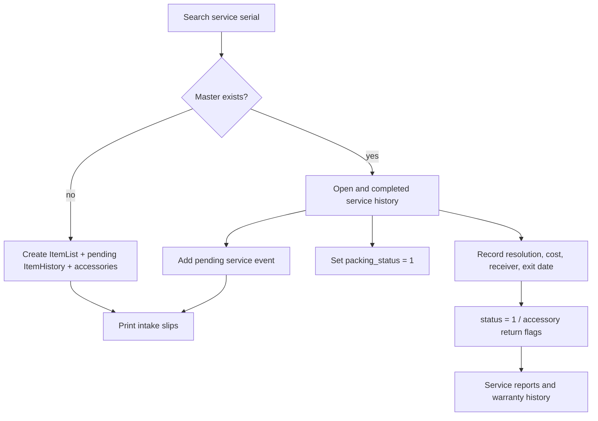
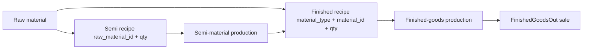
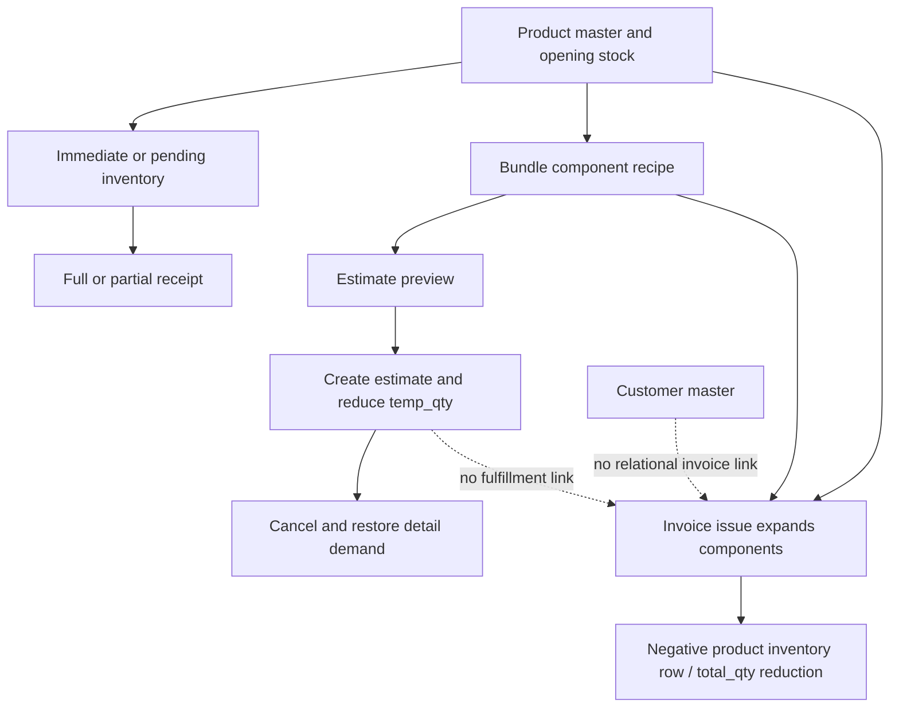

# Galaxy ERP — Workflow Map

> Audit date: **2026-11-05**, Asia/Karachi. This is a read-only application audit of the current working tree, including pre-existing uncommitted branding/table changes. Only these audit documents were created. No improvements described here are implemented or authorized by this report.

[Project Overview](PROJECT_OVERVIEW.md) | [Module Map](MODULE_MAP.md) | [Database Relationships](DATABASE_RELATIONSHIPS.md) | [Workflow Map](WORKFLOW_MAP.md) | [Ui Ux Audit](UI_UX_AUDIT.md) | [Security Audit](SECURITY_AUDIT.md) | [Performance Audit](PERFORMANCE_AUDIT.md) | [Improvement Roadmap](IMPROVEMENT_ROADMAP.md)

## As-is workflow map

These maps describe the **current implementation**, including defects. They are not a corrected business specification. Actor permissions below are the intended menu-facing roles only until SEC-02 is resolved. All proposed calculation/state changes require owner approval and regression tests.

### 1. Login, users, and reference data

- `POST /userLogin` → `LoginController::userLogin` verifies password and establishes web-guard authentication; it does not enforce user status. `GET /user-logout` logs out.
- The user controller creates accounts, edits role/status, and changes another user's password using submitted/route IDs. Roles are not administratively protected on the server.
- Companies, powers, errors, accessories, and units are maintained as simple masters; active filtering is not consistent across selectors.
- There is no idempotent business bootstrap in DatabaseSeeder. Role numbering, company IDs, and transit codes currently rely on the inherited dataset.

### 2. Raw-material receipt and transit

`RawMaterialController::saveInventory` uses transit code **1** for on-hand receipt and other supplied codes for pending transit:

| Path | Counter effects | Inventory row |
|---|---|---|
| Create material | current_stock = temp_stock = submitted opening quantity | No opening receipt movement |
| Immediate receipt | current_stock += q; temp_stock += q | status=1; entry/receiver actor recorded |
| Pending receipt | temp_stock += q; transit_stock += q | status=0; entry actor recorded |
| Receive pending stock | current_stock += row.stock_in; transit_stock -= row.stock_in; temp_stock unchanged | status set to 1; receiver recorded |

The receive handler does not guard status or repeats (STK-02). No allocation or unit conversion is represented. TransitMethod is a master, but application branching assumes numeric codes rather than validated semantic values.

### 3. Semi-raw and finished-goods recipes/production

- Semi recipes append or edit component quantities; finished recipes can refer to Raw or Semi materials.
- Preview handlers calculate recipe quantities and generate HTML inputs with min/max attributes. These previews are not transactional guarantees.
- Production save **trusts posted material IDs/quantities**, creates output inventory, deducts raw/semi current and temp stock, and increments finished output current/temp stock. Omitted component arrays do not prevent output creation.
- Consumption is not posted to one complete signed material ledger. Output, remaining stock, and consumption history live in different structures.
- Legacy finished-goods sales create a sale row and decrement output current/temp quantities only when current_stock is strictly greater than sale quantity; equality fails.

### 4. UPS per-unit manufacturing

- `saveUpsModel` initializes model-level complete/semi counters; `saveUpsModelRecipe` records raw-material requirements.
- `addFinishedUpsModel`: check each recipe row's stock → check duplicate serial → create complete FinishedModels → deduct material quantities → create FinishedModelMaterial rows (`remain_qty=0`). There is no transaction or DB unique serial constraint.
- `addInCompleteUpsModel` (legacy): request `checkedArray` represents **consumed** quantity. It deducts that quantity and records recipe minus consumed as remain_qty.
- `addInCompleteUpsModelNew` (current model_recipe AJAX): request `checkedArray` represents **remaining** quantity. It deducts recipe minus submitted remaining.
- `saveRemainigInventory` (legacy): consumes submitted qty_used. `saveRemainigInventoryNew` (current completion form): consumes old remain minus submitted new remaining.
- The final completion check in both partial methods uses only submitted material IDs, not the whole model requirement set.
- `markCompleteUpsModel` and `markCompleteUpsModelNew` consume all persisted remaining quantities and mark the unit complete; their bodies are identical.
- There is no recipe version, work-order/lot/location ledger, or declared QA-release linkage. Whether those are required is a business-scope question, not authorization to add them.

### 5. Machine testing and unit assignment

`MachineTestingController::saveTesting` collects 20+ measurement/check fields, a duration, board serial, and authenticated tester; an application duplicate-board check is performed. Most fields are nullable strings at schema level. `saveAssignUnit` associates a previously tested board with a unit barcode if neither is already assigned according to application checks. These checks have no unique-constraint/concurrency backing. Role 2's testing list is user-scoped; other route callers receive all records. An existing row is the gate, not a persisted passing QA result.

### 6. Serialization / dispatch metadata

`saveSerialization` and AJAX `addSerialization` store serial/date/model, dealer/customer locality fields, delivery staff text, and actor. They perform duplicate reads before insert; addSerialization does a few presence checks. This is a dispatch/traceability register, not a manufacturing completion or stock issue posting. The model value is a string (the UI may supply a model ID); no FK links it to manufactured units, service masters, or testing.

### 7. Complaints, repair, packing, and delivery

- Search by serial routes to a master history or new-machine form.
- New intake creates ItemList, pending ItemHistory, and optional accessory custody rows. Company and eligible staff selection are hardcoded.
- Repeat intake reads warranty duration from the wrong attribute (`warranty_year` versus stored `warranty_years`); warranty decisions use elapsed absolute days and 365 × years.
- Packing simply sets `packing_status=1`, independently of the service status.
- Exit sets completed status, date/actor, resolution/cost/receiver and selected accessory return flags. Accessory IDs are not scoped to the service history.
- Edits update the selected history and the master model text, not every historical snapshot. No explicit version or state transition lock exists.
- No business rule has been approved for multiple simultaneous open histories, reopening delivered units, or editing a closed service event.

### 8. Products, receipts, customers, estimates, and invoice issues

| Operation | total_qty | temp_qty | Air/sea transit | Document/ledger effect |
|---|---|---|---|---|
| Opening product | set to initial_qty | set to initial_qty | set to zero | Opening quantity stays on master |
| Immediate incoming q | +q | +q | unchanged | Received inventory row, received=q, remaining=0 |
| Pending air/sea q | unchanged | +q | relevant transit +q | Pending row, received=0, remaining=q |
| Partial receipt q | +q | unchanged | relevant transit −q | Existing row received +=q, remaining −=q; closes only at exactly zero |
| Legacy full receipt | +original stock_in | unchanged | relevant transit −original stock_in | status/receiver set; partial counters not reconciled |
| Estimate demand d | unchanged | max(temp_qty−d, 0) | unchanged | Detail quantity_in_stock stores d; quantity_needed stores a non-positive shortage |
| Cancel estimate | unchanged | +detail quantity_in_stock | unchanged | Estimate status=0, details remain; no repeated-cancel guard |
| Invoice issue q | −q per inventory/component | unchanged | unchanged | Header/details, signed negative ProductInventory with transit_id=4 |

Estimate calculations negate the stored non-positive shortage for display. That sign convention is intentional in the current views and is **not** itself reported as a defect. The actual conservation defect is allocation/cancellation mismatch, demonstrated with synthetic arithmetic in STK-05.

Product creation can also create non-inventory/service records and bundles; generated forms/list routes use GET. Bundle issue expansion is one level deep. Customers and named asset/income/expense masters store descriptive information; no receivables or journal posting is implemented.

### 9. Dashboard and reports

- Dashboard total/monthly complaint counts derive from ItemHistory; monthly counts use created_at cohorts. Company/power/error/accessory distributions use grouped queries.
- Daily inbound/outbound charts filter event dates but group creation day (REP-01); chart source is missing (UI-01).
- Reporting and machineList cap at 5,000; all-machine PDF caps masters at 1,000 while the cost total spans all completed histories.
- Custom PDF repeats eight company/power/error combinations. One branch refers to a nonexistent company column; totals do not share selected detail filters; error history is loaded independently inside Blade.
- Product ledger view displays opening quantity plus completed ProductInventory rows. Pending receipts are not included; separate partial-receipt events/reconciliation are not modeled.

## Business decisions required before implementation

1. Define physical/projected/allocated/available quantities and whether negative stock is allowed, by operation and role.
2. Decide whether estimates reserve on-hand only, expected incoming stock, or full demand, and how invoicing fulfills/cancels those allocations.
3. Approve serial identity scopes, recipe versions, unit precision, scrap/variance, retest/rework, and manufacturing quality-release criteria.
4. Define calendar warranty boundaries, future/backdated dates, multiple-open repairs, and creation-cohort versus event-month reports.
5. Decide whether quantity issues are the intended invoice scope or a future finance module is required.

No repair/reconciliation formula, new state model, tax calculation, or historical data correction has been applied.

## Findings

## Confirmed defects

### STK-02 — Full transit receipt can be applied repeatedly

- **Classification / severity:** Confirmed defect / **High**.
- **Exact file and method/section:** [app/Http/Controllers/user_portal/RawMaterialController.php:811](../app/Http/Controllers/user_portal/RawMaterialController.php#L811) — `saveTransitInventory`; [app/Http/Controllers/user_portal/QuickBookController.php:326](../app/Http/Controllers/user_portal/QuickBookController.php#L326) — `markReceivedTransit`.
- **Problem and evidence:** Both handlers update quantities without first checking that the receipt is still pending. The product legacy handler always credits stock_in rather than remaining_stock.
- **Potential impact:** Reopening the same receipt link can credit stock again; a legacy full receipt after a partial receipt can over-credit and leave remaining/received fields inconsistent.
- **Recommended fix:** Lock the receipt, enforce pending state, consume only its outstanding quantity, and return an idempotent result for repeats.
- **Dependencies:** STK-01 and migration of legacy full-receipt UI links.
- **Regression risks:** Reconciliation may be required for historical inconsistent rows, but no automatic repair is authorized.
- **Expected improvement:** A receipt increases on-hand stock once, by its true outstanding amount.

### STK-03 — Partial receipt accepts invalid or excessive quantities

- **Classification / severity:** Confirmed defect / **High**.
- **Exact file and method/section:** [app/Http/Controllers/user_portal/QuickBookController.php:351](../app/Http/Controllers/user_portal/QuickBookController.php#L351) — `markReceivedTransitNew`; [app/Http/Controllers/user_portal/QuickBookController.php:258](../app/Http/Controllers/user_portal/QuickBookController.php#L258) — `saveTransitInventoryNew`.
- **Problem and evidence:** The partial handler subtracts new_quantity without requiring a positive value, a pending record, or new_quantity <= remaining_stock. Unsupported transit IDs leave calculation variables undefined.
- **Potential impact:** Over-receipt can create negative outstanding/transit totals; negative receipt input can reverse movements. Invalid modes fail after part of the operation.
- **Recommended fix:** Validate transit enum and bounds, scope the receipt, reject closed receipts, and calculate all counters within a transaction.
- **Dependencies:** SEC-07, STK-01, STK-02, and integer-versus-decimal policy.
- **Regression risks:** Existing fractional or exceptional receipt practices must be agreed before rejecting them.
- **Expected improvement:** Receipt counters remain bounded and consistent.

### STK-04 — Estimate cancellation releases reservations repeatedly

- **Classification / severity:** Confirmed defect / **High**.
- **Exact file and method/section:** [app/Http/Controllers/user_portal/QuickBookController.php:828](../app/Http/Controllers/user_portal/QuickBookController.php#L828) — `deleteEstimate`.
- **Problem and evidence:** deleteEstimate adds each detail quantity back to temp_qty without checking active status; setting status=0 happens after the additions.
- **Potential impact:** Repeated cancellation credits projected/available stock repeatedly, even when the estimate was already cancelled.
- **Recommended fix:** Lock the active estimate and stock rows, release only the recorded active reservation once, and record cancellation metadata.
- **Dependencies:** STK-01, STK-05, and definition of temp_qty.
- **Regression risks:** Do not infer a corrective amount from current balances alone; historical reconciliation needs approval.
- **Expected improvement:** Cancellation becomes idempotent and cannot manufacture availability.

### STK-05 — Estimate cancellation can release more than was reserved

- **Classification / severity:** Confirmed defect / **High**.
- **Exact file and method/section:** [app/Http/Controllers/user_portal/QuickBookController.php:660](../app/Http/Controllers/user_portal/QuickBookController.php#L660) — `saveProductEstimates`; [app/Http/Controllers/user_portal/QuickBookController.php:828](../app/Http/Controllers/user_portal/QuickBookController.php#L828) — `deleteEstimate`.
- **Problem and evidence:** Saving clamps temp_qty at zero but records full demand in quantity_in_stock. Cancellation restores that full demand, rather than the amount actually deducted.
- **Potential impact:** Pure arithmetic example, not a DB test: available 3 and demand 5 saves 0, then cancellation returns 5 instead of 3. An estimate with no recipe is also created before failure is reported.
- **Recommended fix:** Separate demand, allocated quantity, shortage, and released quantity. Validate recipe existence before creating the estimate; persist a reservation record and release its actual allocation.
- **Dependencies:** Agreed estimate/reservation semantics, STK-07, transactions, and historical reconciliation.
- **Regression risks:** Changing these fields or their signs affects procurement reports and existing reservations. Preserve historical calculations until approved.
- **Expected improvement:** Save/cancel round trips conserve stock availability.

### STK-06 — Invoice issuing does not enforce stock or line validity

- **Classification / severity:** Confirmed defect / **High**.
- **Exact file and method/section:** [app/Http/Controllers/user_portal/QuickBookController.php:890](../app/Http/Controllers/user_portal/QuickBookController.php#L890) — `saveInvoice`.
- **Problem and evidence:** The handler creates the invoice before validating lines and subtracts requested or expanded bundle quantities without a positive-quantity, active-type, sufficient-stock, or aligned-array check. It trusts total_count.
- **Potential impact:** Negative quantities can increase stock; oversized requests can overdraw it; missing/invalid lines leave incomplete invoices or incorrect totals.
- **Recommended fix:** Validate keyed line items, expand approved bundle components server-side, aggregate demand per product, calculate totals, and post atomically with stock checks.
- **Dependencies:** SEC-07, STK-01, bundle-cycle rules, and any approved negative-stock policy.
- **Regression risks:** Some operations may intentionally permit negative stock; treat that as an explicit privileged policy rather than silently changing the rule.
- **Expected improvement:** Only valid, traceable stock issues are posted.

### STK-08 — Material consumption does not create a complete movement ledger

- **Classification / severity:** Confirmed defect / **Medium**.
- **Exact file and method/section:** [app/Http/Controllers/user_portal/RawMaterialController.php:488](../app/Http/Controllers/user_portal/RawMaterialController.php#L488) — `saveSemiRawMaterialProduction`; [app/Http/Controllers/user_portal/RawMaterialController.php:658](../app/Http/Controllers/user_portal/RawMaterialController.php#L658) — `saveFinishedGoodsProduction`; [app/Http/Controllers/user_portal/ModelController.php:148](../app/Http/Controllers/user_portal/ModelController.php#L148) — `addFinishedUpsModel`; [app/Http/Controllers/user_portal/RawMaterialController.php:748](../app/Http/Controllers/user_portal/RawMaterialController.php#L748) — `saveFinishedGoodsSale`.
- **Problem and evidence:** Raw/semi stock is reduced directly during production; output inventories or per-unit material rows are created separately. Raw consumption and finished sales are not represented as a complete signed movement stream in their inventory tables.
- **Potential impact:** Current balances cannot be rebuilt from receipt ledgers alone, and tracing shortages requires traversing multiple partial histories.
- **Recommended fix:** Design an append-only movement ledger with source document, actor, signed quantity, unit, and reversal linkage; reconcile before switching balance ownership.
- **Dependencies:** STK-07, precision, lot/location requirements, and historical source coverage.
- **Regression risks:** Do not backfill invented historical movements. Imports need opening-balance boundaries and reconciliation evidence.
- **Expected improvement:** Auditable movement-to-balance reconciliation.

### PROD-01 — Production save trusts the client material list and consumption

- **Classification / severity:** Confirmed defect / **High**.
- **Exact file and method/section:** [app/Http/Controllers/user_portal/RawMaterialController.php:488](../app/Http/Controllers/user_portal/RawMaterialController.php#L488) — `saveSemiRawMaterialProduction`; [app/Http/Controllers/user_portal/RawMaterialController.php:658](../app/Http/Controllers/user_portal/RawMaterialController.php#L658) — `saveFinishedGoodsProduction`.
- **Problem and evidence:** Save methods create output and credit finished stock even if raw/semi material arrays are omitted. They do not derive recipe requirements or re-check sufficiency at posting time.
- **Potential impact:** A crafted request can produce goods with zero, wrong, or excessive material consumption; the preview min/max attributes are not authoritative.
- **Recommended fix:** At posting, load the approved recipe, derive required material quantities from production output, validate any explicit variance, then lock and post all movements atomically.
- **Dependencies:** Recipe versioning, scrap/variance rules, SEC-07, and STK-01.
- **Regression risks:** The existing UI may permit legitimate manual consumption adjustments. Preserve them as approved variances rather than silently eliminating them.
- **Expected improvement:** Every production output has an approved, server-verified material basis.

### PROD-02 — Partial manufacturing completion checks only submitted material IDs

- **Classification / severity:** Confirmed defect / **High**.
- **Exact file and method/section:** [app/Http/Controllers/user_portal/ModelController.php:473](../app/Http/Controllers/user_portal/ModelController.php#L473) — `saveRemainigInventory`; [app/Http/Controllers/user_portal/ModelController.php:770](../app/Http/Controllers/user_portal/ModelController.php#L770) — `saveRemainigInventoryNew`.
- **Problem and evidence:** Material IDs are not scoped to model_id, and the final outstanding check uses whereIn(submitted IDs), not all materials belonging to the finished model.
- **Potential impact:** Submitting a completed subset can mark a unit complete while other required materials remain outstanding; unrelated material rows can also be changed.
- **Recommended fix:** Resolve materials through the selected unit, validate keyed inputs against its outstanding requirements, and compute completion over the complete persisted requirement set.
- **Dependencies:** SEC-02, STK-01, both old/new client contracts, and manufacturing state rules.
- **Regression risks:** The old handler consumes requested quantity; the new handler treats input as remaining quantity. Preserve those meanings during migration.
- **Expected improvement:** A unit becomes complete only when all of its own requirements are satisfied.

### PROD-03 — Legacy partial completion checks the wrong required amount

- **Classification / severity:** Confirmed defect / **Medium**.
- **Exact file and method/section:** [app/Http/Controllers/user_portal/ModelController.php:473](../app/Http/Controllers/user_portal/ModelController.php#L473) — `saveRemainigInventory`.
- **Problem and evidence:** The legacy handler checks stock against the entire remain_qty, then consumes the submitted qty_used without checking that input against stock or remaining demand.
- **Potential impact:** A legitimate partial consumption can be rejected (remaining 10, stock 5, requested 3); a crafted oversized request can bypass the intended bounds after the wrong check.
- **Recommended fix:** Validate the requested consumption against both on-hand stock and the remaining requirement, then update within a transaction.
- **Dependencies:** Caller inventory: the shared current completion form posts to the New handler, so this is a reachable legacy endpoint rather than proof of current UI usage.
- **Regression risks:** Do not transplant the fix to the New remaining-quantity contract without translating the input meaning.
- **Expected improvement:** Correct partial-consumption bounds for legacy callers.

### SERV-01 — Repeat-service warranty uses a nonexistent field

- **Classification / severity:** Confirmed defect / **High**.
- **Exact file and method/section:** [app/Http/Controllers/user_portal/IndexController.php:291](../app/Http/Controllers/user_portal/IndexController.php#L291) — `saveMachineInfo`; [app/Models/ItemList.php:12](../app/Models/ItemList.php#L12) — `$fillable`; [database/migrations/2023_03_03_165203_update_item_list_table_two.php:14](../database/migrations/2023_03_03_165203_update_item_list_table_two.php#L14) — `up`.
- **Problem and evidence:** saveMachineInfo reads warranty_year, while persistence and new-machine intake use warranty_years.
- **Potential impact:** The warranty duration is evaluated as null/zero in the repeat-service path, so otherwise-covered units can be treated as out of warranty.
- **Recommended fix:** Use the agreed persisted field through a shared warranty calculation, then characterize boundaries and historical nullable values before changing outcomes.
- **Dependencies:** SERV-03, warranty policy, and intake/edit forms.
- **Regression risks:** Correcting this changes business decisions. Test existing examples and do not rewrite previously stored warranty_status automatically.
- **Expected improvement:** Consistent warranty classification for new and repeat intake.

### SERV-02 — Service intake depends on hardcoded company and staff IDs

- **Classification / severity:** Confirmed defect / **Medium**.
- **Exact file and method/section:** [app/Http/Controllers/user_portal/IndexController.php:164](../app/Http/Controllers/user_portal/IndexController.php#L164) — `saveNewMachineInfo`; [app/Http/Controllers/user_portal/IndexController.php:148](../app/Http/Controllers/user_portal/IndexController.php#L148) — `addNewMachineInfo`; [app/Http/Controllers/user_portal/IndexController.php:274](../app/Http/Controllers/user_portal/IndexController.php#L274) — `addMachineInfo`; [app/Http/Controllers/user_portal/IndexController.php:888](../app/Http/Controllers/user_portal/IndexController.php#L888) — `editMachine`.
- **Problem and evidence:** New intake forces company_id to a numeric literal instead of the selected/authorized company; staff selectors load a fixed pair of user IDs. The request user selection is read but not used for assignment.
- **Potential impact:** Fresh or migrated installations can assign records to the wrong company or omit eligible staff, and the UI may imply an assignment that is not stored.
- **Recommended fix:** Resolve the company from an approved business rule and eligible staff from permissions/status; define whether the selected staff member is an assignee distinct from the authenticated entry actor.
- **Dependencies:** Role matrix, company ownership, DB-07, and historical reporting expectations.
- **Regression risks:** Changing existing company assignments or staff attribution requires separate data approval.
- **Expected improvement:** Portable intake and accurate company/assignment attribution.

### SERV-04 — Accessory return updates are not scoped to the service history

- **Classification / severity:** Confirmed defect / **High**.
- **Exact file and method/section:** [app/Http/Controllers/user_portal/IndexController.php:383](../app/Http/Controllers/user_portal/IndexController.php#L383) — `saveExitMachine`.
- **Problem and evidence:** Submitted accessory IDs are loaded globally with ItemHistoryAccessory::find and updated without verifying item_history_id matches the exiting history.
- **Potential impact:** A request can mark another service record’s accessories as returned. No such mutation was attempted.
- **Recommended fix:** Resolve accessory IDs through the current history relation, authorize the transition, and atomically post the exit and returns.
- **Dependencies:** SEC-02, SEC-07, accessory custody policy, and STK-01 transaction pattern.
- **Regression risks:** Older forms may submit unrelated IDs accidentally; surface validation errors rather than silently skipping them.
- **Expected improvement:** Accessory custody remains attached to the correct service event.

### SALE-01 — Finished-goods sale rejects selling the exact available quantity

- **Classification / severity:** Confirmed defect / **Medium**.
- **Exact file and method/section:** [app/Http/Controllers/user_portal/RawMaterialController.php:748](../app/Http/Controllers/user_portal/RawMaterialController.php#L748) — `saveFinishedGoodsSale`.
- **Problem and evidence:** The condition is current_stock > sale_quantity rather than allowing equality.
- **Potential impact:** Selling the final available units is rejected despite sufficient stock. Negative quantities are also not rejected, covered by SEC-07.
- **Recommended fix:** After confirming the sale policy, validate positive quantity and allow equality within the same transactional stock check.
- **Dependencies:** Approved stock policy, SEC-07, and STK-01.
- **Regression risks:** If retaining a minimum reserve is intentional, represent it explicitly rather than hiding it in a strict comparison.
- **Expected improvement:** The stock-quantity boundary behaves according to the declared policy.

### REP-01 — Dashboard event charts group by record creation day

- **Classification / severity:** Confirmed defect / **High**.
- **Exact file and method/section:** [app/Http/Controllers/user_portal/IndexController.php:23](../app/Http/Controllers/user_portal/IndexController.php#L23) — `index`.
- **Problem and evidence:** Inbound chart queries filter entry_date but group DAY(created_at); outbound queries filter exit_date but also group DAY(created_at).
- **Potential impact:** Backdated entries and deliveries of older repairs are shown on the creation day rather than the actual event day.
- **Recommended fix:** Use the same agreed event-date field for range filtering and grouping, with a frozen-time regression fixture.
- **Dependencies:** SERV-03 month/timezone definitions and missing chart source UI-01.
- **Regression risks:** Charts will change when creation and event dates differ; this needs explicit calculation approval.
- **Expected improvement:** Daily inbound/outbound series represent their declared events.

### REP-02 — Company-only custom report uses a nonexistent column

- **Classification / severity:** Confirmed defect / **High**.
- **Exact file and method/section:** [app/Http/Controllers/user_portal/IndexController.php:594](../app/Http/Controllers/user_portal/IndexController.php#L594) — `customMachineDataPDF`.
- **Problem and evidence:** The branch with company selected and power/error=any filters item_histories.company, but migrations and inspected schema contain company_id, not company.
- **Potential impact:** That filter combination generates a SQL error instead of the report.
- **Recommended fix:** Use the correct field in a unified report query and test all eight company/power/error combinations without changing business calculations.
- **Dependencies:** Existing input values and REP-03 filter/total agreement.
- **Regression risks:** Consolidation must preserve join and date semantics for each existing branch.
- **Expected improvement:** Company-only reports execute successfully.

### REP-03 — Custom report footer totals ignore selected filters

- **Classification / severity:** Confirmed defect / **High**.
- **Exact file and method/section:** [app/Http/Controllers/user_portal/IndexController.php:594](../app/Http/Controllers/user_portal/IndexController.php#L594) — `customMachineDataPDF`.
- **Problem and evidence:** Every branch calculates machine_cost using only date range and completed status; detail rows additionally filter company, power, and/or error.
- **Potential impact:** A report can display a grand total for unrelated records instead of the sum of its displayed groups.
- **Recommended fix:** Derive detail and total from the same approved filtered query/scope and assert footer equals grouped-detail sum.
- **Dependencies:** REP-02 and choice of master-versus-history company/model fields.
- **Regression risks:** Join behavior can exclude orphan records, so a sum over a different table may still disagree even after filters match.
- **Expected improvement:** Totals reconcile to the exact report population.

### REP-04 — Reports silently cap their supposedly complete population

- **Classification / severity:** Confirmed defect / **High**.
- **Exact file and method/section:** [app/Http/Controllers/user_portal/IndexController.php:454](../app/Http/Controllers/user_portal/IndexController.php#L454) — `downloadMachineData`; [app/Http/Controllers/user_portal/IndexController.php:416](../app/Http/Controllers/user_portal/IndexController.php#L416) — `reporting`; [app/Http/Controllers/user_portal/IndexController.php:471](../app/Http/Controllers/user_portal/IndexController.php#L471) — `machineList`; [resources/views/panels/sidebar.blade.php:219](../resources/views/panels/sidebar.blade.php#L219) — `Download All Machine Data`.
- **Problem and evidence:** The all-machine export selects only the latest 1,000 machines, and report/list queries limit 5,000 histories without a visible truncation notice. The export cost total covers all completed histories.
- **Potential impact:** Users can mistake partial records for a complete audit/export and see population-mismatched totals.
- **Recommended fix:** Separate paginated interactive views from a complete bounded/queued export, carry filters consistently, and show record count/scope or an explicit cap warning.
- **Dependencies:** Performance capacity, export ownership, and REP-03 reconciliation.
- **Regression risks:** Removing caps without pagination/streaming may exhaust memory. Completeness and performance must be fixed together.
- **Expected improvement:** Honest report scope and complete exports through a controlled path.

### REP-05 — In-factory machine list includes delivered histories

- **Classification / severity:** Confirmed defect / **Medium**.
- **Exact file and method/section:** [app/Http/Controllers/user_portal/IndexController.php:471](../app/Http/Controllers/user_portal/IndexController.php#L471) — `machineList`.
- **Problem and evidence:** The view is labeled In Factory Machine List, but the query does not filter status=0.
- **Potential impact:** Delivered and open records are mixed under a status-specific title, causing operational confusion.
- **Recommended fix:** Confirm whether the page is all-history or in-factory; then align the query or label and filter controls to that approved purpose.
- **Dependencies:** Slip-print selection workflow and user expectations.
- **Regression risks:** Adding a status filter could hide historical slips that staff currently print from this page.
- **Expected improvement:** A list whose population matches its stated purpose.

### REP-06 — Custom PDF error details are outside report scope

- **Classification / severity:** Confirmed defect / **Medium**.
- **Exact file and method/section:** [resources/views/user_portal/Report/custom-machine-report-download.blade.php:182](../resources/views/user_portal/Report/custom-machine-report-download.blade.php#L182) — `App\Models\ItemList::where`; [app/Models/ItemList.php:24](../app/Models/ItemList.php#L24) — `machineHistory`.
- **Problem and evidence:** For each report row the Blade template loads a master by serial and then iterates all completed machineHistory records, without the report date/company/power/error filters.
- **Potential impact:** Displayed error names can refer to events outside the summarized report scope; duplicate master serials can select a different machine. The same code also creates N+1 queries.
- **Recommended fix:** Load scoped detail data keyed by stable item ID in the report query, keeping the view presentation-only.
- **Dependencies:** REP-03, DB-03, and PERF-02.
- **Regression risks:** Clarify whether error details should list matching events or all historical errors; label the latter explicitly if intentional.
- **Expected improvement:** Report detail fields and aggregates describe the same population.

## Potential risks and design questions

### STK-01 — Multi-record stock writes lack transactions and locks

- **Classification / severity:** Potential risk / **High**.
- **Exact file and method/section:** [app/Http/Controllers/user_portal/QuickBookController.php:890](../app/Http/Controllers/user_portal/QuickBookController.php#L890) — `saveInvoice`; [app/Http/Controllers/user_portal/QuickBookController.php:258](../app/Http/Controllers/user_portal/QuickBookController.php#L258) — `saveTransitInventoryNew`; [app/Http/Controllers/user_portal/RawMaterialController.php:98](../app/Http/Controllers/user_portal/RawMaterialController.php#L98) — `saveInventory`; [app/Http/Controllers/user_portal/ModelController.php:148](../app/Http/Controllers/user_portal/ModelController.php#L148) — `addFinishedUpsModel`.
- **Problem and evidence:** No transaction, row-lock, or atomic stock-update calls were found in business controllers. A single operation updates multiple records using separately loaded quantities.
- **Potential impact:** A failure can persist partial operations; concurrent writers can lose updates or oversubscribe stock. These outcomes were not induced against live records.
- **Recommended fix:** Centralize each operation in one transaction, lock affected stock rows in a consistent order, and handle retries/idempotency explicitly.
- **Dependencies:** SEC-07, DB-02, DB-03, and a documented stock invariant.
- **Regression risks:** Locking can introduce deadlocks or contention. Keep transactions short and test rollback and concurrent requests in isolated MySQL.
- **Expected improvement:** All-or-nothing operations and controlled concurrent stock movement.

### STK-07 — Projected stock and reservation semantics are not unified

- **Classification / severity:** Potential risk / **High**.
- **Exact file and method/section:** [app/Http/Controllers/user_portal/QuickBookController.php:258](../app/Http/Controllers/user_portal/QuickBookController.php#L258) — `saveTransitInventoryNew`; [app/Http/Controllers/user_portal/QuickBookController.php:660](../app/Http/Controllers/user_portal/QuickBookController.php#L660) — `saveProductEstimates`; [app/Http/Controllers/user_portal/QuickBookController.php:890](../app/Http/Controllers/user_portal/QuickBookController.php#L890) — `saveInvoice`; [app/Http/Controllers/user_portal/RawMaterialController.php:98](../app/Http/Controllers/user_portal/RawMaterialController.php#L98) — `saveInventory`.
- **Problem and evidence:** temp_qty includes incoming transit and is reduced by estimates; invoices reduce total_qty but not temp_qty and do not link an estimate. The raw-material system uses separate current/temp/transit counters. No approved invariant or conversion contract is documented.
- **Potential impact:** Projected stock can become disconnected from physical stock or double-count reservations/fulfillment. Whether each divergence is wrong depends on the intended business meaning.
- **Recommended fix:** Agree equations for on-hand, in-transit, allocated, projected, and available stock; define estimate fulfillment and cancellation before consolidating the two systems.
- **Dependencies:** Business owner decision; all receipt, estimate, invoice, and production workflows.
- **Regression risks:** A simplistic temp_qty = total_qty repair would discard transit/reservation semantics. No recalculation is proposed without approval.
- **Expected improvement:** One explainable availability model and trustworthy reconciliation.

### PROD-04 — Duplicate recipe components can defeat per-line availability checks

- **Classification / severity:** Potential risk / **High**.
- **Exact file and method/section:** [app/Http/Controllers/user_portal/ModelController.php:96](../app/Http/Controllers/user_portal/ModelController.php#L96) — `saveUpsModelRecipe`; [app/Http/Controllers/user_portal/ModelController.php:148](../app/Http/Controllers/user_portal/ModelController.php#L148) — `addFinishedUpsModel`; [app/Http/Controllers/user_portal/RawMaterialController.php:295](../app/Http/Controllers/user_portal/RawMaterialController.php#L295) — `saveSemiRawMaterialRecipe`; [app/Http/Controllers/user_portal/QuickBookController.php:1149](../app/Http/Controllers/user_portal/QuickBookController.php#L1149) — `updateBundleProducts`.
- **Problem and evidence:** Recipe rows are appended without component uniqueness; checks compare each row to stock separately rather than aggregating repeated component demand. Bundle updates allow any existing product ID, including nested bundles or self-reference.
- **Potential impact:** If duplicate components or unsupported bundle structures exist, total demand can exceed stock even when each row passes. Existing recipes were not inspected for these cases.
- **Recommended fix:** Define component uniqueness and permitted bundle nesting; aggregate requirements per material/product and validate cycle/type rules.
- **Dependencies:** Legacy recipe data, recipe versioning, SEC-07, and transactions.
- **Regression risks:** Merging duplicate rows changes semantics where duplicates represent distinct operations; preserve operation labels if required.
- **Expected improvement:** Availability checks use the complete material demand.

### PROD-05 — Manufacturing counters and serial lifecycle are disconnected

- **Classification / severity:** Potential risk / **Medium**.
- **Exact file and method/section:** [app/Http/Controllers/user_portal/ModelController.php:36](../app/Http/Controllers/user_portal/ModelController.php#L36) — `saveUpsModel`; [app/Http/Controllers/user_portal/ModelController.php:148](../app/Http/Controllers/user_portal/ModelController.php#L148) — `addFinishedUpsModel`; [app/Http/Controllers/user_portal/ModelController.php:711](../app/Http/Controllers/user_portal/ModelController.php#L711) — `markCompleteUpsModelNew`; [app/Http/Controllers/user_portal/SerializationController.php:74](../app/Http/Controllers/user_portal/SerializationController.php#L74) — `addSerialization`.
- **Problem and evidence:** UPSModel exposes qty/temp_qty/semi_qty counters, but finished-unit creation/completion does not update them. Manufacturing, testing, serialization, and service each store their own serial/model identity without foreign-key linkage.
- **Potential impact:** Different screens may show incompatible manufacturing totals or independent identities. The intended use of the counters is undocumented.
- **Recommended fix:** Decide the authoritative per-unit lifecycle and which aggregate counters are derived; link testing, shipping, and service identities through a stable unit reference.
- **Dependencies:** DB-03, historical serial mapping, retest/rework rules, and STK-07.
- **Regression risks:** Do not merge serial namespaces or recalculate counters until mapping conflicts are resolved.
- **Expected improvement:** End-to-end traceability from materials to shipped and serviced units.

### PROD-06 — Testing records do not enforce a quality-release decision

- **Classification / severity:** Potential risk / **High**.
- **Exact file and method/section:** [app/Http/Controllers/user_portal/MachineTestingController.php:24](../app/Http/Controllers/user_portal/MachineTestingController.php#L24) — `saveTesting`; [app/Http/Controllers/user_portal/MachineTestingController.php:115](../app/Http/Controllers/user_portal/MachineTestingController.php#L115) — `saveAssignUnit`; [database/migrations/2024_04_26_164526_create_machine_testings_table.php:14](../database/migrations/2024_04_26_164526_create_machine_testings_table.php#L14) — `up`.
- **Problem and evidence:** Test measurements/checks are nullable strings; there is no persisted pass/fail/release state, threshold validation, or link to a manufactured unit. Assignment requires a test row, not an approved test result.
- **Potential impact:** An incomplete or failing test may still permit unit assignment if quality release is intended to depend on these checks. Approved acceptance criteria were not supplied.
- **Recommended fix:** Define model-specific test requirements, units, acceptable ranges, pass/fail/retest/approval states, and release permissions before enforcing them.
- **Dependencies:** Engineering/QA sign-off, schema additions, barcode uniqueness, and historical test treatment.
- **Regression risks:** Do not invent electrical thresholds or retroactively mark units failed; clarify the workflow first.
- **Expected improvement:** A documented and enforceable manufacturing quality gate.

### SERV-03 — Warranty and reporting date semantics need a single policy

- **Classification / severity:** Potential risk / **Medium**.
- **Exact file and method/section:** [app/Http/Controllers/user_portal/IndexController.php:867](../app/Http/Controllers/user_portal/IndexController.php#L867) — `warrantyCheck`; [app/Http/Controllers/user_portal/IndexController.php:164](../app/Http/Controllers/user_portal/IndexController.php#L164) — `saveNewMachineInfo`; [app/Http/Controllers/user_portal/IndexController.php:561](../app/Http/Controllers/user_portal/IndexController.php#L561) — `monthlyComplete`; [config/app.php:70](../config/app.php#L70) — `'timezone'`.
- **Problem and evidence:** Warranty uses 365*years and an absolute date difference; future production dates are not rejected. Some dates use Carbon now(+5), others application timezone/month boundaries. Monthly resolved statistics filter creation date rather than exit date.
- **Potential impact:** Leap-year, future-date, backdated-intake, and month-boundary decisions can disagree with business expectations. Creation-cohort reporting may be intentional.
- **Recommended fix:** Agree calendar-anniversary warranty rules, timezone handling, and creation-cohort versus event-month report definitions; implement only after approval.
- **Dependencies:** Historical dates, DB types, customer warranty terms, REP-01, and tests with a frozen clock.
- **Regression risks:** Changing calendar rules changes warranty outcomes and monthly totals; preserve existing meaning until signed off.
- **Expected improvement:** Documented and consistent date-based business decisions.

### SERV-05 — Service transitions and edits lack explicit state guards

- **Classification / severity:** Potential risk / **Medium**.
- **Exact file and method/section:** [app/Http/Controllers/user_portal/IndexController.php:291](../app/Http/Controllers/user_portal/IndexController.php#L291) — `saveMachineInfo`; [app/Http/Controllers/user_portal/IndexController.php:363](../app/Http/Controllers/user_portal/IndexController.php#L363) — `markAsPacked`; [app/Http/Controllers/user_portal/IndexController.php:383](../app/Http/Controllers/user_portal/IndexController.php#L383) — `saveExitMachine`; [app/Http/Controllers/user_portal/IndexController.php:906](../app/Http/Controllers/user_portal/IndexController.php#L906) — `saveEditMachine`.
- **Problem and evidence:** Repeated intake can create multiple open histories; packing and exit do not enforce a transition graph; editing changes both the current history model and the master model, while other snapshots remain unchanged.
- **Potential impact:** Replayed or out-of-order actions can overwrite exit metadata or create ambiguous current state. Multiple open histories or editable delivered units may be legitimate business choices.
- **Recommended fix:** Define allowed reopen/pack/exit/edit transitions, repeat-intake rules, and historical snapshot policy; enforce authorization and concurrency checks accordingly.
- **Dependencies:** Service owner sign-off, historical reporting, and identity model.
- **Regression risks:** Do not impose one-open-history or immutable-close rules without checking real workshop practices.
- **Expected improvement:** Predictable state transitions with preserved service history.

### SALE-02 — Current invoices are quantity-issue documents, not a full finance ledger

- **Classification / severity:** Potential risk / **High**.
- **Exact file and method/section:** [app/Models/Invoice.php:12](../app/Models/Invoice.php#L12) — `$fillable`; [app/Models/InvoiceDetails.php:12](../app/Models/InvoiceDetails.php#L12) — `$fillable`; [app/Http/Controllers/user_portal/QuickBookController.php:890](../app/Http/Controllers/user_portal/QuickBookController.php#L890) — `saveInvoice`; [app/Models/Customer.php:12](../app/Models/Customer.php#L12) — `$fillable`.
- **Problem and evidence:** Invoices persist a free-text recipient, document number, line product/quantity, and total_count; no customer FK, price/tax snapshots, payments, receivable ledger, or invoice-to-estimate fulfillment link is implemented.
- **Potential impact:** Treating these documents as complete financial invoices or customer-account balances would overstate the implemented accounting scope. A quantity-only issue slip may be the intended requirement.
- **Recommended fix:** Document the present scope; obtain requirements for monetary invoicing, tax, payments, returns, and customer linkage before adding a finance subsystem.
- **Dependencies:** Accounting owner approval, customer master mapping, numbering, inventory reservation semantics, and migration strategy.
- **Regression risks:** Do not relabel historical issue quantities as money or introduce tax formulas without approval.
- **Expected improvement:** Clear accounting boundaries and a requirements-led expansion path.

### SALE-03 — Bundle replacement is destructive and not transactional

- **Classification / severity:** Potential risk / **High**.
- **Exact file and method/section:** [app/Http/Controllers/user_portal/QuickBookController.php:1149](../app/Http/Controllers/user_portal/QuickBookController.php#L1149) — `updateBundleProducts`.
- **Problem and evidence:** The method updates the product, deletes all component rows, then recreates them. Validation checks each array independently but not aligned keys. Existing estimates/invoices refer to products without a recipe version.
- **Potential impact:** A mid-operation failure can leave a partial or empty recipe; editing a bundle changes future expansion without preserving which recipe an earlier operation used.
- **Recommended fix:** Validate keyed components and type/cycle rules, replace atomically, and snapshot/version recipes where historical reproducibility is required.
- **Dependencies:** STK-01, PROD-04, historical fulfillment policy, and client array shape.
- **Regression risks:** Recipe versioning affects how active estimates are fulfilled; agree whether they retain their original recipe.
- **Expected improvement:** Atomic edits and reproducible document component requirements.
